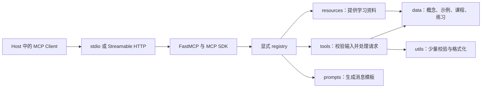

# learn-mcp-server 官网对照与后续改进报告

检查日期：2026-10-08（Asia/Shanghai）  
项目目录：E:/SoftwareProject/learn-mcp-server  
代码基准：6b8d7d96692cf6139b06bbcefbe7dc378ee34b67  
项目定位：用于学习 MCP 的 MCP Server，优先保持架构简单、依赖方向清晰、示例可以运行。

本报告回答三个问题：哪些内容需要添加，哪些内容需要修改，以及哪些地方值得改进。实施建议属于后续工作，本次没有升级依赖或修改业务代码。

## 1. 结论与优先顺序

当前项目的骨架已经合适：入口创建 FastMCP，registry 集中注册，tools/resources/prompts 提供接口，data 保存教学内容，utils 做少量校验。继续沿用这条调用链即可。增加数据库、插件自动发现、服务层、后台任务平台或 Web 前端，都不能优先解决当前教学问题。

最需要提升的是“内容准确、例子完整、学习反馈可靠”。现有项目已经能展示三种核心原语，但许多文档只有定义，尚未展示输入 schema、结果结构、错误差异、客户端观察方法和对应验收过程。

还有一个需要先处理的版本问题：项目实际运行在 FastMCP 3.3.1 / MCP Python SDK 1.27.2，SDK 支持的最新协议修订是 2025-11-25；检查时官网当前规范是 2026-07-28，FastMCP 默认文档已进入 4.x。这些版本不能混在同一套无版本标记的示例中。

建议按以下顺序推进：

1. **先纠正教学结论和已确认的输入缺陷**：增加版本声明，修正生命周期、roots、tasks、配置边界，修复学习计划、答案反馈和错误诊断。
2. **补足最小学习闭环**：一份完整 Server 示例、一份完整 Client 示例，以及 schema、结构化结果、Resource MIME、Prompt messages 和错误处理课程。
3. **提升课程质量和验证能力**：分级目标、主题专属练习标准、可发现的说明元数据、真实 stdio/HTTP 冒烟验证。
4. **单独安排新版协议和 FastMCP 4 兼容验证**：先说明变化，再在隔离环境验证；确认后才切换主课程运行基线。

近期可以将 FastMCP 依赖约束在已验证的 3.x 范围内，配合锁文件和依赖公告复核。这个建议用于稳定当前课程，不代表长期停留在旧版本。主课程切到 4.x 应作为一项明确、可验收的迁移任务。

## 2. 检查依据、范围与限制

### 2.1 检查了哪些官网

主要依据是 MCP 官网和 FastMCP 官网：

- [MCP 官网文档索引](https://modelcontextprotocol.io/llms.txt)：用于发现版本化规范、概念说明、Inspector、安全教程和扩展。
- [FastMCP 官网文档索引](https://gofastmcp.com/llms.txt)：用于定位默认 4.x 文档与版本化 3.x 文档。
- MCP 2025-11-25 与 2026-07-28 的相关规范：核对当前运行基线与最新变化。
- FastMCP 3 的 Server、Client、Tools、Resources、Prompts、Context、测试和部署文档：核对现有代码可采用的 API。
- FastMCP 3 → 4 升级指南：识别会影响课程和客户端代码的变化。
- PyPI 官方包元数据：额外核对当前包版本和 Python 要求。

本次检索并抓取了 **112 个相关官方页面**，重点核读与项目相关的规范条款、API 章节和迁移说明。这是针对本项目的内容对照，不是对官网全部页面、全部 SDK、全部客户端的穷尽审计。

来源留痕见：

- [112 个页面的来源目录](E:/SoftwareProject/learn-mcp-server/docs/archive/2026-10-08/official-review-2026-10-08/source-catalog.md)。
- [来源 URL、响应状态、章节与 SHA-256 清单](E:/SoftwareProject/learn-mcp-server/docs/archive/2026-10-08/official-review-2026-10-08/source-manifest.json)。
- [包版本和 SDK 支持版本记录](E:/SoftwareProject/learn-mcp-server/docs/archive/2026-10-08/official-review-2026-10-08/package-version-metadata.json)。
- [补充示例的实际验证结果](E:/SoftwareProject/learn-mcp-server/docs/archive/2026-10-08/official-review-2026-10-08/recommended-example-probe.json)。

官网正文快照保存在本次研究的系统临时目录，没有将约 1.47 MB 的外部文档正文复制进项目。来源清单中的 hash 对应获取时的 HTTP 响应字节；官网后续更新后，同一 URL 的内容可能变化。

### 2.2 如何使用上一轮项目检查

本报告沿用 [项目详细检查报告](E:/SoftwareProject/learn-mcp-server/docs/archive/2026-10-08/project-audit-2026-10-08.md) 的代码检查与运行证据，没有把已经完成的全部测试再重复一遍。

| 基线项 | 已确认结果 |
| --- | --- |
| 项目版本 | 0.1.0 |
| Python | 3.10.18 |
| FastMCP / MCP SDK | 3.3.1 / 1.27.2 |
| 注册能力 | 20 Tools、39 静态 Resources、5 Resource Templates、5 Prompts |
| 教学数据 | 23 概念、8 代码示例、4 配置说明、5 调试指南、3 课程、10 练习 |
| 原有测试 | 99 / 99 通过 |
| 语句 / 分支覆盖 | 91.25% / 65.625% |
| 真实传输 | stdio 子进程和本地 HTTP 验证通过 |
| 包分发 | sdist / wheel 构建和独立 wheel 安装验证通过 |

本次新增验证使用当前环境中的 FastMCP API，实际确认了参数说明、对象形式结构化结果、ToolError、Prompt 多消息、Context 注入、进度回调和 Resource MIME 行为。**这些验证没有证明 FastMCP 4 升级已经通过，也没有证明所有 Host 均支持所有能力。**

### 2.3 结论分类

| 标记 | 含义 | 处理原则 |
| --- | --- | --- |
| 必须修改 | 当前内容会误导学习者，或已有逻辑缺陷 | 优先修正 |
| 建议添加 | 学习核心 MCP 时有明确缺口 | 用最小完整示例补齐 |
| 建议改进 | 已有功能可以更清楚、更可靠 | 复用现有模块 |
| 版本对照 | 最新规范与当前环境不同 | 标明适用版本，避免直接混用 |
| 可选专题 | 不影响当前入门学习闭环 | 先讲概念，按需要提供独立示例 |

规范中的 MUST / SHOULD 应按对应协议版本、能力和适用前提解释。不能把新版规范的要求直接当成旧版运行栈的实现缺陷，也不能因为框架支持某项能力就要求主 Server 必须使用它。

## 3. 必须先讲清楚的版本关系

### 3.1 四个版本分别是什么

| 版本维度 | 当前项目 | 检查时的最新信息 | 课程应如何表达 |
| --- | --- | --- | --- |
| 本项目版本 | 0.1.0 | 本次未发布新版本 | 用于识别学习服务自身 |
| FastMCP 版本 | 3.3.1 | PyPI 返回 4.0.11；默认官网是 4.x | 装饰器、Client、Context 示例需标明主版本 |
| MCP Python SDK | 1.27.2 | PyPI 返回 2.3.0 | 决定底层协议类型与支持范围 |
| MCP 协议修订 | SDK 最高支持 2025-11-25 | 官网当前规范 2026-07-28 | 说明线上的消息流程和行为 |

当前安装 SDK 的支持列表实际为：2024-11-05、2025-03-26、2025-06-18、2025-11-25。此前真实连接验证返回 2025-11-25。没有检测到当前运行栈支持 2026-07-28 的证据。

PyPI 元数据中，FastMCP 4.0.11 和 MCP 2.3.0 均声明 Python >=3.10。因此不能仅凭主版本升级就声称项目必须升级到 Python 3.11 或更高；是否升级 Python 应另按兼容测试和维护需要决定。

`FastMCP(..., version=...)` 中的 version 是**服务实现版本**，这里应是本项目的 0.1.0。它不是 MCP 协议修订，也不应填 2026-07-28 来宣称协议升级。框架默认返回自身版本导致的 F11 问题，可以通过显式传入项目版本处理。[S04]、[S16]

### 3.2 新旧协议的重要差异

| 主题 | 2025-11-25 基线 | 2026-07-28 | 对本项目的影响 |
| --- | --- | --- | --- |
| 初始化 | initialize → initialized 通知 → 后续请求 | 删除这组握手 | 现有生命周期章节必须加版本边界 |
| 版本与客户端能力 | 初始化时交换 | 每个请求的 `_meta` 携带 | 添加版本对照课程，当前代码交给 SDK 处理 |
| 服务发现 | initialize 返回服务信息、能力，再 list | Server 必须实现 server/discover；Client 可选择先调用 | 讲清 discover 与 list 的区别 |
| 协议会话 | HTTP 可有 Mcp-Session-Id | 删除协议级会话和该 header | 不将当前 session 教成永恒机制 |
| Server 请求客户端信息 | 旧版独立服务端请求 | MRTR：input_required → Client 补输入后重试 | 新增概念图和报文对照 |
| HTTP GET / 订阅 | GET 流及 resources/subscribe 等 | subscriptions/listen 统一订阅 | 作为新版章节，不手写兼容层 |
| 返回结果 | 无统一 resultType 要求 | 普通结果 complete，中间结果 input_required | 教学观察结果时标明时代 |
| HTTP 标准 header | 旧版要求集合 | 新增 Mcp-Method、适用方法的 Mcp-Name 等 | 由框架实现；课程解释观察到的 header |
| 缓存提示 | 无新式通用要求 | 指定完成结果必须有 ttlMs、cacheScope | 讲缓存语义，不引入 Redis |
| Tasks | 核心中的实验性能力 | 官方扩展 io.modelcontextprotocol/tasks | 更新“实验性方向”的无版本描述 |
| Roots / Sampling / Logging | 可选协议能力 | 已弃用，暂时仍保留 | 保留历史专题，降低新增实现优先级 |
| ping / logging/setLevel / roots 变更通知 | 存在 | 删除 | 新版课程不要沿用旧版命令 |
| SSE 恢复 | 可以涉及 event ID / Last-Event-ID | 删除恢复与重投递机制，断流须以新 ID 重发请求 | 解释新版行为和副作用重试风险 |
| structuredContent | 旧版为对象形式 | 可为符合输出 schema 的任意 JSON 值 | 3.x 示例继续用对象，另讲新规范 |
| Resource 不存在 | -32002 | -32602；客户端仍应接受旧码 | 错误码测试需标明版本 |
| OAuth 动态注册 | 可选 DCR | DCR 弃用，优先 Client ID Metadata Documents | 更新授权概览，主项目不自建 OAuth |

依据：[S02]、[S03]、[S05]、[S06]、[S07]、[S08]、[S09]、[S10]。

Roots、Sampling、Logging 的“弃用”不等于“已删除”。官网要求至少保留十二个月，最早有资格移除的时间是 2027-07-28 及之后的规范修订。新实现 SHOULD NOT 采用这些能力，但旧项目和旧 Host 的行为仍值得学习。[S03]

同样，弃用的 HTTP+SSE 旧传输不等于 SSE 技术不再使用。Streamable HTTP 仍可以使用 SSE 返回流。应把“传输协议版本”和“HTTP 流编码技术”分开讲。[S02]、[S07]

### 3.3 建议的近期版本策略

1. 在 README 顶部与课程总览明确标注：主课程当前基于 FastMCP 3.3.1、SDK 1.27.2、2025-11-25 协议。
2. 添加“2026-07-28 规范变化”章节，说明它属于最新规范对照，当前运行栈尚未提供这套实测示例。
3. 将 `fastmcp` 的无上限依赖改为经过验证的主版本范围，例如以 `>=3.3.1,<4` 为候选；最终下限需结合安全公告和可用补丁验证确定。
4. README、代码示例、课程资源使用对应 `/v3/` 官网链接；升级课程使用默认 4.x 文档。
5. 切换主版本时同步调整锁文件、文档标签、客户端示例和测试，不只改一行依赖。

开发环境的 uv.lock 可以固定当前依赖；发布 wheel 的使用者通常不会使用仓库 uv.lock，因此 pyproject.toml 中的兼容范围也需要表达教学基线。版本约束不能代替依赖漏洞维护。

## 4. 官网内容与项目覆盖情况

“已有介绍”表示存在文字；“已有实现”表示主服务或示例真实实现了能力。二者不能互相替代。

| 官网主题 | 当前覆盖 | 主要缺口 | 建议层级 |
| --- | --- | --- | --- |
| MCP 定位 | 已有介绍 | 需补协议、框架、Host 产品的区别 | 入门改进 |
| Host / Client / Server | 已有介绍 | 只有短定义；缺完整交互图和责任分工 | 入门添加 |
| Tool / Resource / Prompt 控制方 | 有定义 | Resource 的 application-controlled 与 Prompt 的 user-controlled 未讲清 | 必须修改 |
| Tool 注册 | 真实实现 | 缺从函数到 list_tools schema 的对照 | 核心添加 |
| 类型、默认值、字段说明 | 有类型注解 | 缺 Literal / Annotated / Field 和验证模式讲解 | 核心添加 |
| Tool 返回 | 以 str 为主 | 缺 content / structuredContent / outputSchema / data 的关系 | 核心添加 |
| Tool 错误 | 有 ValueError 片段 | 缺 JSON-RPC error 与 isError 对照、Client 异常处理 | 核心添加 |
| Tool annotations | 未声明 | 缺行为提示与安全边界区别 | 轻量改进 |
| Resource 列表 / 读取 | 真实实现 | 缺元数据与内容两层结构 | 核心添加 |
| MIME / text / blob | 未形成课程 | Markdown 默认 text/plain，缺 JSON、二进制示例 | 核心添加，二进制可选 |
| Resource Template | 真实实现 | 仅简单占位符，缺编码、可选查询参数和验证规则 | 中级添加 |
| Prompt 列表 / 获取 | 真实实现 | 缺 wire 字符串参数、messages 角色、不会自动调用模型 | 必须说明 |
| Completion | 未形成课程 | 不知道参数补全和文本生成的区别 | 中级概念，实现可选 |
| stdio | 真实支持 | 缺进程生命周期、stderr、非交互通信解释 | 核心改进 |
| Streamable HTTP | 真实支持 | 缺与普通 REST 的区别、header/媒体类型、版本边界 | 中级添加 |
| Origin 防护 | 之前实际验证存在缺口 | 外部 Origin 被接受 | 近期修复 |
| JSON-RPC | 有短定义 | 缺请求、结果、错误、无 id 通知的完整报文 | 核心添加 |
| 生命周期 / 版本 | 旧版介绍 | 缺 initialized 细节，且未标明新版删除握手 | 必须修改 |
| Capability 与能力清单 | 有旧版介绍 | 把能力类别和具体工具发现混在一起 | 必须修改 |
| 最新 discover / per-request metadata | 未介绍 | 当前官网的重要入口变化 | 版本对照添加 |
| MRTR | 未介绍 | 旧版回调模型不足以解释新版 | 高级版本对照 |
| 通知 / 进度 | 有通知定义 | 无可观察进度回调，缺 token 与请求关系 | 中级可运行示例 |
| 取消 / 超时 | 未形成课程 | 缺客户端控制与业务副作用边界 | 中级添加 |
| Logging | 仅 stdout 注意事项 | 缺普通 stderr 日志和协议日志的区别、弃用状态 | 工程实践 / 历史专题 |
| Pagination | 未形成课程 | 缺 cursor / nextCursor 概念 | 中级说明即可 |
| 缓存提示 | 未介绍 | 新版 ttlMs / cacheScope 的意义 | 新版专题 |
| 订阅 / listChanged | 有泛化通知定义 | 缺旧 subscribe 与新 listen 的区别 | 可选版本对照 |
| Elicitation | 有介绍 | 无 accept / decline / cancel 和 form / URL 模式说明 | 中级概念，示例可选 |
| Sampling | 有介绍 | 未标明新规范弃用，无 Host 能力前提 | 历史专题修改 |
| Roots | 有介绍 | 把信息提示写成访问边界，未标明弃用 | 必须修改 |
| Authorization | 有泛化介绍 | 未说明 HTTP OAuth 范围与 stdio 凭证方式 | 必须修改 |
| 本地安全 / 提示注入 | 有安全列表 | 缺真实边界，容易让人以为 Host 确认能约束 OS 权限 | 核心改进 |
| Tasks | 有实验性介绍 | 未标明旧版与官方扩展的变化 | 必须修改，主服务不实现 |
| Apps / Skills / Auth 扩展 | 未介绍 | 不清楚扩展与核心三原语的关系 | 高级概览即可 |
| Inspector | README 有命令 | 课程命令不一致；新版 Inspector 有协议时代设置 | 近期改进 |
| Client 测试 | 有内存 Client 脚本 | 命名和描述未强调绕过真实传输 | 近期改进 |
| Host 配置 | 有通用 JSON | 未强调 mcpServers 是生态格式、Host 各有配置约定 | 必须说明 |
| 打包 / 安装 | 已验证可用 | 示例搬移后需要验证包内文件与项目外运行 | 工程实践保留 |

这一表不意味着要为每一行增加一个 Tool 或静态 Resource。多数新增内容可以进入现有 data 字典，通过现有查询 Tool 和 Resource Template 暴露。

## 5. 当前必须修改的内容

### M01：生命周期和能力协商需要明确适用版本

位置：[data/concepts.py](E:/SoftwareProject/learn-mcp-server/src/learn_mcp_server/data/concepts.py)、[concept_resources.py](E:/SoftwareProject/learn-mcp-server/src/learn_mcp_server/resources/concept_resources.py)、[data/curriculum.py](E:/SoftwareProject/learn-mcp-server/src/learn_mcp_server/data/curriculum.py)。

当前 client 概念、capability-negotiation 概念和高级课程都以 initialize 为通用起点；生命周期资源也写成“连接通常从 initialize 开始”。这适用于当前旧版栈，但对 2026-07-28 已不成立。

建议修改：

- 标题或正文标注“2025-11-25 及以前的初始化流程”。
- 补全 initialize request、initialize result、notifications/initialized、后续 list/call/read/get、关闭传输的步骤。
- 单独解释：capabilities 表示能力类别，不包含完整的 Tool 参数清单；具体能力需调用相应 list 方法。
- 新版章节说明每请求 `_meta` 与 server/discover，不修改当前 Server 去伪造新协议。

验收：读者能判断当前服务器为什么出现 initialize，以及为什么新版官方报文没有这条握手。[S01]、[S02]、[S05]、[S06]

### M02：纠正三种原语的控制模型

Tool 是 model-controlled，Resource 是 application-controlled，Prompt 是 user-controlled。它们描述典型使用决策由谁控制，不是由协议强制规定某种 UI，也不代表可以绕过权限判断。[S11]、[S12]、[S13]

当前课程将 Resource 简化成“模型可以读取的上下文”、Prompt 写成“让用户或模型复用”，没有形成这一关键区别。

建议让同一个学习主题展示三种入口：Tool 根据输入计算或查询结果；Resource 提供可读取资料；Prompt 返回供用户选择的任务消息。说明 Host 决定如何把 Resource 加入上下文，获取 Prompt 不会自动启动模型生成。

验收：用户能解释为什么一个资料查询同时可能有 Tool 和 Resource，但两者的协议入口与控制方式不同。

### M03：roots 不提供自动沙箱，并应标明弃用

当前位置将 roots 写成“可访问工作区范围”“限制边界”。应改成“客户端告知 Server 的相关目录或文件提示”。协议不强制 Server 留在 roots 中，实际权限限制需要 OS、容器、Host 沙箱或 Server 自己的路径检查。[S03]、[S25]

同时标明：2026-07-28 已弃用；官网建议新实现通过 tool 参数、resource URI 或 server 配置传递目录/文件。当前主项目没有文件访问需求，无需增加真实 roots 功能。

验收：课程明确写出“roots 不自动限制文件系统权限”，并避免提供全盘扫描练习。

### M04：更新 tasks 的定位

当前位置两处都只说“实验性方向”。应分开写：2025-11-25 中为实验性核心能力；2026-07-28 后转为官方 Tasks 扩展，标识为 io.modelcontextprotocol/tasks。[S02]、[S29]

新版扩展也调整了结果获取与交互方式，不能把旧版 tasks/result、tasks/list 流程继续标成新规范。主 Server 的静态查询不需要任务存储、Docket 或后台队列。

验收：Tasks 概念页有版本对照和“何时普通异步 Tool 已足够”的说明。

### M05：授权、用户确认和本地进程权限应分别说明

协议 Authorization 主要规范 HTTP 传输的访问授权；它是可选能力，支持时按相应规范实现。stdio 应通过环境等方式取得所需凭证，不套用这套 HTTP OAuth 流程。[S10]

用户确认执行某个 Tool，与 HTTP 请求是否被授权，是两个不同层次。启动本地 Server 进程后，它通常拥有启动账号的 OS 权限；协议和普通 uv/uvx 虚拟环境不会自动给它建立文件或网络沙箱。[S33]

建议添加一张边界表：Host 交互确认、HTTP 身份与 token、Server 输入检查、OS 实际权限。当前课程以静态内容为主，保留本地默认用法；公开 HTTP 部署才需要完整身份授权方案。

验收：不能再把“Host 已确认”或“运行在 uvx 隔离环境”解释成操作系统权限隔离。

### M06：配置解释器的对象与字段校验

位置：[config_tools.py](E:/SoftwareProject/learn-mcp-server/src/learn_mcp_server/tools/config_tools.py)。详细复现见原检查 F02、F03、F04。

| 输入 | 当前问题 | 建议结果 |
| --- | --- | --- |
| 合法 JSON 的 [] / null / 字符串 / 数字 / 布尔 | 对非对象调用 .get 产生 AttributeError | 明确提示配置根必须是对象 |
| mcpServers 不是对象 | 不能可靠按预期结构解释 | 返回字段级错误 |
| command 不是非空字符串 | 可能仍被解释成 stdio | 指出 command 类型或空值错误 |
| args 不是字符串数组 | 可能被接受 | 给出数组和元素要求 |
| command 与 url 同时存在 | 传输冲突被忽略 | 提示当前工具支持的配置结构中不可混用 |
| javascript:alert(1) 等 URL | generate_http_config 只检查非空 | 仅接受有有效主机的 http / https 地址 |

使用标准库 JSON 和 urllib.parse 加少量函数足够。检查 URL 时不应向目标地址发起请求，因此这仍是静态配置校验工具。

补充说明：mcpServers JSON 是生态中广泛采用的配置约定，不是所有 Host 都必须使用的 MCP wire protocol 格式。工具应声明自己检查哪种格式，不声称可解析所有 Host 配置。[S32]

验收：错误配置得到可理解的诊断，原有合法示例仍可解释，敏感环境变量值不被无条件回显。

### M07：删除“必须用 uv/uvx 才是正确 stdio”的暗示

位置：[data/configs.py](E:/SoftwareProject/learn-mcp-server/src/learn_mcp_server/data/configs.py)。目前 common-errors 将 command 未使用 uvx，以及未指向 uvx 或 uv，列成通用错误。

MCP stdio 可以使用有效的 Python、Node、二进制或其他可执行命令。uv/uvx 是本项目推荐的 Python 安装运行方式，并非协议要求。[S24]、[S32]

建议改成“命令不可执行、PATH 不正确、解释器环境不匹配、工作目录或包版本错误”。README 推荐 uv 的说明可以保留。

验收：一个有效的 python 启动配置不会仅因没有 uv 被判成错误。

### M08：分级学习计划必须真正不同

位置：[practice_tools.py](E:/SoftwareProject/learn-mcp-server/src/learn_mcp_server/tools/practice_tools.py)。当前三种等级只有标题不同，正文完全一致；未知 level 静默变为 beginner。[原检查 F05]

建议复用现有 CURRICULUMS 或同文件中的简单计划数据；入门侧重运行与三原语，中级侧重 schema、返回和传输，高级侧重版本、边界、迁移。不要创建课程服务层。

未知 level 应明确返回可选项，或者由 Literal 输入 schema 限制。采用哪种方式需与直接 Python 调用的一致校验配套。

验收：三种计划的目标、练习和产出确有区别，未知等级不被默默替换。

### M09：关键词反馈不能冒充语义判卷

check_answer 当前只要出现任一关键词就肯定答案；单独回答“tool”，甚至包含关键词的否定错误句子，也可能得到“答得不错”。这会把不正确的知识反馈给学习者。[原检查 F06]

建议保留简单确定性实现：输出“覆盖了哪些检查点、还缺哪些检查点”，明确这是关键词辅助自查。为每个主题设置必需检查点，并加入典型误解提示。不要为了判卷给项目增加外部 LLM 依赖，也不要声称几条否定词规则能完成语义判断。

若需要深度点评，可让现有 Prompt 请求 Host 中的模型审阅回答，并说明其输出是建议，不能替代代码运行验证。

验收：只有一个关键词的回答不会获得整体正确结论；输出始终呈现自查局限和下一步验证动作。

### M10：学习建议和主题目录需要一致

suggest_next_step(debug) 推荐 tests，但 CONCEPTS 没有 tests；再输入 tests 又回到 Tool，形成无法完成的衔接。[原检查 F07]

建议添加 tests 主题和实践说明，定义完成节点；将推荐序列放入一份小型数据表，并验证所有目标存在。完成最后主题后返回“进入综合练习/复习”，不回到起点。

验收：推荐主题、课程、练习、URI 和概念目录之间没有悬空引用。测试只需针对这些关联约束，不需要引入图引擎。

### M11：错误诊断应先匹配具体证据

位置：[debug_tools.py](E:/SoftwareProject/learn-mcp-server/src/learn_mcp_server/tools/debug_tools.py)。目前包含 FastMCP 的连接拒绝错误会被优先解释成依赖问题，stdout JSON 错误也可能被归为配置问题。[原检查 F10]

建议规则顺序：明确连接拒绝/超时 → 端点与网络；明确 stdout 解析失败 → 协议通道；明确 import/module 错误 → 依赖；明确配置字段错误 → 配置。没有足够证据时列出候选原因和验证动作，避免单一断言。

验收：典型错误能够给出相应排查顺序，未知问题提示需要哪些信息；无需添加自动执行诊断命令的能力。

### M12：Inspector、Prompt 参数和项目版本元数据

- 课程中的 Inspector 命令与 README 不一致，应统一可替换的绝对路径、对象后缀和重载说明。[原检查 F14]
- 最新 Inspector 有 legacy / auto / modern 协议时代设置。当前 v3 课程使用旧版基线；不要要求它连接 modern 后仍能成功。该设置属于 Inspector 版本能力，应在版本提示中介绍。[S34]
- generate_mcp_study_plan 应约束 days 范围，例如建议 1–30 天，并在正文明确这是项目产品规则，不是协议限制；level、topic、code、error 也应校验空值。[原检查 F09]
- 创建 FastMCP 时传入项目 version 和简洁 instructions，并为 Prompt、静态 Resource 添加说明。[原检查 F11、F13]

验收：协议发现的服务版本对应本项目；列表能解释各能力用途；非法天数不会生成荒谬计划。

### M13：HTTP Origin 和依赖维护不能靠“学习项目”跳过

原检查 F01 实测外部 Origin 仍能初始化。旧版与新版 Streamable HTTP 都要求验证 Origin；新版明确无效 Origin 返回 403。绑定 127.0.0.1 值得保留，但不是授权边界。[S07]、[S33]

建议优先使用当前 SDK / FastMCP 公开防护配置；若没有适当入口，再考虑很小的中间件。Host 白名单可辅助防护，不能代替 Origin 检查；CORS 也不能等同于这项检查。无 Origin 的合法非浏览器客户端应继续可用。

依赖扫描发现的是公告记录，不能把 29 个去重公告直接称为 29 个已可利用漏洞。应按锁定版本、实际传输路径、修复版本逐个复核；升级补丁后重新验证真实传输和打包即可，不需要为学习项目引入庞大供应链平台。

验收：非法 Origin 被拒绝，合法本地客户端仍可用；依赖处理记录区分“受影响版本”“项目可达路径”和“已验证修复”。

## 6. 建议添加的核心学习内容

以下建议尽量复用现有 get_code_example、explain_concept、Resource Template 和课程接口。新增的主题不需要各自拥有一组新的 Tool。

### A01：一份完整可运行的最小 Server

当前 basic-tool、basic-resource、basic-prompt 示例都只有装饰器片段；直接复制时缺少 import、FastMCP 实例和启动入口。建议保留片段用于解释，同时增加完整入口。[S16]、[S17]、[S18]、[S19]

一个完整示例应有：

- `from fastmcp import FastMCP`，并说明独立 FastMCP 包与 SDK 内嵌 FastMCP 的区别。
- 创建名为 learning-demo 的实例，给出服务 version 和 instructions。
- 一个简单 Tool、一个静态 Resource、一个 Template 和一个 Prompt。
- `if __name__ == ...` 保护启动入口，默认 stdio。
- 命令、预期发现清单、成功调用参数和预期结果。
- 示例版本标签，避免读者复制进不同主版本后无法判断原因。

**建议产出**：先新增一个 examples/minimal_server.py，不替换主 Server，不引入第二套通用注册框架。

**练习**：将加法 Tool 改成单位换算，随后从 Client 观察工具名字、参数和返回。

**验收**：运行命令能够启动；Client 发现三原语并完成各一次交互；导入示例模块不会自动启动阻塞服务。

### A02：schema 与业务校验

新增课程应从现有 explain_concept、generate_learning_plan 等函数出发，展示函数签名如何形成 inputSchema。[S11]、[S17]

| 学习点 | 最小示例 | 需要观察的结果 |
| --- | --- | --- |
| 必需参数 | 无默认值的 topic: str | required 中包含 topic |
| 默认参数 | limit: int = 5 | 允许省略，服务使用默认值 |
| 枚举 | Literal 等级 | schema 呈现可选值 |
| 字段说明 | Annotated 配合 Field | properties 中有说明 |
| 数值范围 | days 的上下界 | 越界输入得到可解释错误 |
| 类型转换 | 输入字符串形式数字 | 说明 v3 默认灵活验证，不假设严格模式 |
| 业务限制 | 分母不能为零 | schema 类型正确仍可能触发业务错误 |

保持两个层次：类型和 schema 帮客户端理解结构，业务校验负责语义限制。直接调用普通 Python 函数时不会自动获得注册层的全部校验，必要的业务规则仍应在函数中实现。

建议先用 Literal、标准类型和一两个 Annotated 字段；只有示例需要表达稳定对象结构时才加入一个 TypedDict 或小型 Pydantic model。不要给每个返回字符串创建 model。

**验收**：在 Client.list_tools() 中看到预期 schema；缺字段、错误列表元素、合法可转换值和业务非法值分别有明确结果。

### A03：结构化 Tool 返回与客户端读取

当前多数工具返回 Markdown 字符串，这对教学文档合适，但不能完整展示结构化 MCP 结果。[S11]、[S17]、[S21]

需要添加这组对照：

| 名称 | 所属层 | 含义 |
| --- | --- | --- |
| Python 返回值 | 示例函数 | 开发者 return 的对象或文本 |
| content | MCP 结果 | 给客户端的文本、图像等内容块 |
| structuredContent | MCP wire 结果 | Server 产生的机器可读数据 |
| outputSchema | Tool 元数据 | 描述并约束结构化结果 |
| result.data | FastMCP Client | 框架按 schema 还原后的 Python 数据 |
| result.structured_content | FastMCP Client | 框架对象上的结构化 JSON 属性 |

result.data 是 FastMCP 的便捷接口，不是 JSON-RPC 报文必然存在的字段。也要区别 MCP structuredContent 与 LLM 的 schema 约束输出；前者是 Server 结果数据。

当前 v3 示例使用对象形式最清楚，例如 `dict[str, float]` 返回一个 value 字段。本次实际验证确认其 inputSchema、outputSchema 和 structured_content 正常生成。不要为了追求新版任意 JSON 返回能力，在当前 v3 课程直接使用新版原始结果形状。

**建议产出**：在最小示例中用一个数值 Tool 返回对象；现有讲解工具继续返回易读文本。若今后 get_server_info 确有客户端消费需求，再增加结构化信息，避免全量返回值迁移。

**验收**：既能读取 content，也能读取 structured_content/data；声明输出 schema 的示例返回与 schema 一致。

### A04：错误处理的完整闭环

目前的 ValueError 片段只解释“可以抛异常”，尚未解释 Client 会收到什么。[S11]、[S17]、[S21]

建议用同一个 Tool 演示三种情况：成功计算、合法结构但业务失败、未知工具/格式不合法。课程区分：

- **JSON-RPC 协议错误**：请求方法、名字或结构存在问题，表现为 error 对象。
- **Tool 执行错误**：工具能够被调用，但执行失败，表现为工具结果 isError。
- **Client SDK 异常**：FastMCP Client 默认会对工具错误抛 ToolError；raise_on_error=False 可观察结果。

函数抛出的异常类型、框架转换后的协议结果、客户端抛出的异常，不应讲成同一个对象。具体参数非法如何分类，还需结合版本、校验发生层和实际 SDK 结果说明。

本次实际验证了 `raise ToolError(...)` 和 Client 的 `raise_on_error=False`，结果的 is_error 为 true。示例错误应使用可理解的用户文本，避免暴露堆栈、路径或凭证。

mask_error_details 是可选框架配置：适合讲解错误细节管理，无需把所有输入错误都隐藏成无法调试的统一消息。

**验收**：读者能指出失败发生在哪一层；测试检查错误状态和内容，不只检查某个关键词出现。

### A05：Resource 元数据、内容与 MIME

Resource 课程应明确：resources/list 返回可发现的元数据，resources/read 返回实际 contents。模板则通过 resources/templates/list 暴露 URI 模式，不会预先列出所有参数组合。[S12]、[S18]、[S22]

建议增加两个核心例子：Markdown 文档和 JSON 元数据。二进制 blob 用简短概念示例即可，当前项目无图片业务，无需添加图像依赖。

| 内容 | 建议 MIME | 实现注意 |
| --- | --- | --- |
| Markdown 学习页 | text/markdown | 注册元数据和实际 read 结果都应核对 |
| 纯文本 | text/plain | 不必为了形式统一改成 Markdown |
| JSON 元数据 | application/json | 用 json.dumps 显式序列化，先保持过程可见 |
| 二进制 | 具体 MIME 或 application/octet-stream | 在线上用 blob/base64；不用在业务函数手写协议编码 |

**本次实测发现的版本细节**：FastMCP 3.3.1 中，静态 JSON Resource 声明 application/json 后读取结果正确；Template 声明 text/markdown、返回普通 str，读取内容仍为 text/plain。Template 显式返回 ResourceResult，其中内容项为指定 MIME 的 ResourceContent 后，读取结果为 text/markdown。

因此后续不能只检查模板列表的 mimeType。可以先接受纯文本并在课程说明，或者在确需 Markdown 类型的模板中使用这份已验证的返回形式：

```python
from fastmcp.resources import ResourceContent, ResourceResult

def topic_content(name: str) -> ResourceResult:
    return ResourceResult([
        ResourceContent(f"# {name}", mime_type="text/markdown")
    ])
```

这段是返回内容的片段，完整注册和启动放入完整示例。该现象属于当前框架版本行为，不应表述成项目所有资源无法读取。不要修改 site-packages 来解决课程问题。

还需讲明 annotations 的类型：Resource/content 标准 annotations 主要是 audience、priority、lastModified；ToolAnnotations 则有 readOnlyHint 等行为提示。FastMCP v3 的资源文档部分示例把行为提示写在资源 annotations 中，不能把该写法当作 MCP 标准字段。增加元数据时以规范、当前类型和实际序列化结果共同核对。

**验收**：静态与模板读取都检查 contents 的 URI、text/blob 和 MIME；JSON 内容能解析；读者能区别资源列表和资源正文。

### A06：Resource Template 的有效参数和 URI 边界

当前已有 mcp://concepts/{name}，适合作为第一例。应增加：RFC 6570 概念、参数名与函数签名对应、URI 编码、查询参数默认值、未知名称行为。[S12]、[S18]

FastMCP v3 文档说明：无默认值的必需参数应出现在路径模板；`{?param}` 查询参数应是有默认值的可选参数；模板变量应存在于函数参数中。用一个 query 参数例子足够，复杂路径展开留作链接。

自定义 mcp:// URI 合法，只需遵循 URI 规范。它不意味着存在一个可在浏览器中访问的 HTTP 网站；Resource URI 与 HTTP 服务 /mcp endpoint 是不同地址层。

当前静态 URI 和模板 URI 部分可能匹配同一内容；如为兼容已有 URI 保留，应说明别名关系，并验证模板路由确实被覆盖到。

**未知主题处理决策**：无匹配 URI 应由框架报告资源不存在；模板匹配但 name 不在教学字典中，可以设计为“返回帮助页”，也可以明确报告不存在。需写清语义，避免把成功的帮助文本当作成功读取目标主题。

**验收**：一个有效参数、一个未知参数、一个查询参数和必要编码情况均有可解释结果；不在示例中增加任意本地文件路径读取。

### A07：Prompt 是消息模板，不是自动执行的模型请求

需要解释 prompts/list、prompts/get、arguments 和 messages；协议 Prompt 参数在线上传递为字符串，FastMCP 可以转换成函数声明的类型。[S13]、[S19]、[S23]

本项目 days: int 可作为最小转换例子：通过协议字符串传入数字，由框架转换，再由业务校验约束范围。不要把 Tool 的 JSON 类型输入与 Prompt 的字符串参数直接画等号。

返回 str 在当前 FastMCP 中会形成一条 user 消息；多消息示例可用 Message 指定 user / assistant。协议 PromptMessage 的 role 是这两个值，不要把普通 LLM API 的 system 消息直接当成该结构。

review_mcp_code 和 debug_mcp_error 中，用户代码/错误应被明确界定为“待分析数据”。代码包含 Markdown fence 或诱导指令时，显示与数据边界应尽量保持清楚。这可以改善模型使用体验，但不保证通过文本界定就能消除提示注入。

**建议产出**：在完整示例增加一组两条消息；现有五个 Prompt 补充 description、参数说明、等级与空值校验，避免新增大量同类 Prompt。

**验收**：get_prompt 返回 messages；其角色、内容和字符串参数转换符合说明；获取模板不会自行调用外部 LLM。

### A08：完整 Client 闭环与真实传输差异

当前 examples/client_test.py 用 Client(mcp) 连接内存实例，只列清单并调用 get_server_info。它适合注册/API 检查，但不验证命令启动、管道通信、端口、Origin 或网络。[S20]、[S21]、[S22]、[S23]、[S24]

建议完善成三个层次，尽量复用同一组检查函数：

1. 内存：list_tools / list_resources / list_resource_templates / list_prompts，随后 call_tool / read_resource / get_prompt。
2. stdio：用显式 StdioTransport 启动当前项目，验证 console script、环境、工作目录和 stdout。
3. HTTP：连接已运行的本地 URL，验证 endpoint、媒体类型、header 和 Origin 行为。

命令路径、网络代理环境、超时和退出清理需要被清楚说明。HTTP 例子默认仅连接本地测试服务；无需添加外网依赖。

补充进程关系：stdio Client 通常负责启动并管理 Server 子进程；HTTP Client 连接独立运行的服务。HTTP Server 退出与 Client 离开连接上下文不是相同事件。

**验收**：一个完整脚本能读取资源和获取 Prompt；模式名称准确；真实子进程与 HTTP 测试有超时、清理和独立本地端口，不残留后台进程。

### A09：JSON-RPC 报文与观察方法

新增四组带注释的短报文：request、success response、error response、notification。说明 id 用于关联请求，通知没有 id，不需要 response；响应的 result 与 error 不应同时存在。[S01]、[S02]、[S11]

还应解释 MCP 是约定好的方法、类型与交互语义，不是“随便调用一个 Python 函数后输出 JSON”。HTTP /mcp 也不等于常见 REST endpoint；浏览器 GET 成功与否不能单独判定 MCP 是否可用。

报文必须附协议版本。新版例子携带 `_meta`，普通结果包含 resultType；旧版 initialize 例子放在旧版章节。课程图为简化时，应显式说明省略了哪些字段，避免把残缺 JSON 教成可直接发送的规范请求。

**验收**：读者可从 Inspector 中定位方法、参数、id、结果和错误，而不用修改 SDK 或实现 JSON-RPC parser。

### A10：Context、进度、超时和取消

Context 是 FastMCP 的框架能力，MCP 规范本身不定义一个 Python Context 类。当前 v3 可用 CurrentContext() 注入；ctx 参数不出现在 Tool 输入 schema 中。[S26]、[S27]

建议独立进阶示例模拟三个固定步骤，调用 report_progress，并由 Client progress_handler 记录。无需睡眠数十秒、访问网络或建立队列。本次已验证进度 1 → 2 → 3 与 total=3 正常到达。

同步简单计算继续用普通函数；等待 I/O 的例子才需要 async。async 关键字不自动产生异步 I/O，当前 async-tool 的 fetch_status(url) 只是返回 ok，应改成准确名称或真实但确定性的演示。

超时和取消课程需要说明：客户端停止等待，不等于已经发生的外部动作被回滚；取消是合作行为。对于有副作用的操作，重试还需要业务幂等设计。本项目示例先用纯计算避免这些副作用。

协议 Logging 在新版已弃用，不要为了演示 Context 进度而顺带把旧版 ctx.info 作为主课程必需特性。普通 stderr 日志仍可用于本地排查。

**验收**：ctx 不暴露给模型作为可填参数；进度能在 Client 观察；超时后资源被清理；说明取消与回滚的区别。

### A11：测试、打包与教学内容的一致性

添加 tests 概念页以修复学习链，同时讲四个不同验证目标：普通函数逻辑、MCP 暴露形状、真实传输、已安装包可用性。[S28]

不需要仅为了匹配官方示例而引入 pytest-asyncio；现有 asyncio.run 测试可以继续使用。未来只有并发 fixture 或异步生命周期明显需要时再添加。

内容验证重点应是关联约束和教学语义：所有推荐主题存在、课程 URI 可读取、版本标签一致、示例可运行、错误状态正确。不要增加只重复实现常量或检查同一句关键词的测试。

打包部分尤其要注意：pyproject.toml 当前 wheel 只包含 src/learn_mcp_server。将可运行示例放到仓库 examples 后，安装包不会自动包含它们。应在下述两种策略中明确选择：

- 初期保留 data/examples.py 为运行时展示文本，仓库 examples 为可执行示例，以测试校验关键内容一致。
- 后续确需单一源码来源时，将示例作为包内明确声明的资源，用 importlib.resources 读取，并验证 wheel 内容。

不要让已安装 Server 在运行时读取仓库相对路径 examples，或依赖当前工作目录存在 docs。

**验收**：在仓库外运行已安装包时，学习资料和示例仍可获取；测试明确对应哪一种保障。

## 7. 最新规范需要添加的版本专题

这一组先增加讲解、对照表和观察指南。主 Server 升到支持新规范的框架后，再加入可运行示例。

### V01：server/discover 与每请求 metadata

讲清 server/discover 返回支持版本、能力与身份信息；它对新版 Server 是必需，对 Client 是否预先调用则是可选。它不是完整 Tool schema 清单，也不是要开发者自己再注册一个同名普通 Tool。[S05]、[S06]

每请求 `_meta` 中说明 protocolVersion、clientCapabilities，以及建议携带的 clientInfo；Server 身份在结果 metadata 中表达。HTTP 的 MCP-Protocol-Version header 与请求声明需一致。

**练习**：对照旧版 initialize 报文和新版 discover / 普通请求，找出信息从连接阶段移到每请求的位置。

### V02：MRTR 与请求补充输入

通过“选择学习等级后继续生成计划”的假想流程解释：原始请求 → input_required 结果 → Client 收集输入 → 用新 JSON-RPC id 重试原始方法并附 inputResponses / requestState → complete。[S08]

requestState 是 Server 定义的不透明字符串；Client 不应解读、修改或假定格式。不要教 Client 去解析其中业务状态，也不要把它直接等同于 session id。

MRTR 课程需要与“FastMCP 4 中旧 ctx.elicit 在 modern 连接上受限”的框架现实并列说明。规范定义模式，不代表每个框架都在相同接口上提供完整便利 API。

**验收**：读者能解释为什么新版 Server 不再发送旧版独立回调请求；示例不手写状态存储与加密系统。

### V03：subscriptions/listen 与通知

解释一次请求相关的进度通知和独立变化订阅之间的区别；新版统一订阅使用 subscriptions/listen，包含确认、subscriptionId 关联和取消。旧版资源订阅、HTTP GET 推送流应保留在历史对照中。[S09]

当前教学内容不会在运行中动态变更，所以主 Server 无需主动推送课程变更。若未来要演示动态资料，使用一个独立示例即可。

### V04：ttlMs / cacheScope 与缓存边界

官网要求在 discover、相关 list 和资源读取的完成结果中携带缓存提示；input_required 中间结果不缓存。ttlMs 是新鲜度提示，cacheScope 表达 public / private，共享范围不等于用户授权。[S15]

给一个“内置概念资料可以在适当时间内复用”的示例即可。课程同时说明参数与权限上下文影响结果；带 MRTR 输入的重试结果不能按普通 cache key 复用。

主项目不需要新增缓存服务、缓存数据库或通用失效引擎。框架负责协议结果，Client 按需求缓存。

### V05：核心、可选能力、扩展与弃用

新增一页解释分类：

- 核心基础：消息结构、对应版本的发现机制与传输规则。
- 能力：tools/resources/prompts 等，按实现声明。
- 可选支持：completion、用户补充信息等，不能假设所有 Host 支持。
- 官方扩展：Tasks、Apps、Skills、Auth 扩展，另有协商和客户端支持范围。
- 弃用能力：在当前规范仍可能存在，但新设计不优先加入。

Apps 的 UI/iframe 通信、Skills 的 skills/list/get 与资源文件读取值得做概览，尚不需要为本项目引入前端框架或技能文件服务。[S29]、[S30]、[S31]、[S35]

**验收**：读者不会把“官网有这个功能”理解成“每个 MCP Server 都必须实现”。

### 7.6 可选专题的最小边界

**Completion。** 这里是 Prompt 参数或 Resource Template 参数的候选值补全，不是调用模型续写文本。例如输入主题前缀 res，可建议 resource、resource-template。规范以 completion/complete、ref/prompt 或 ref/resource 表达，结果包含 values，并可包含 total、hasMore；一份响应最多提供 100 个值。支持时需声明 completions 能力，并确认 Host/Client 接入方式。[S14]

对当前项目，先增加概念和报文解释即可。若当前高层框架没有经过核实的公开注册方式，暂不实现；不为演示一项可选功能侵入 SDK 私有 handler，也不复制未经验证的装饰器参数。

**Pagination。** 讲清 list 类结果中的 nextCursor，以及后续请求的 cursor；cursor 是不透明字符串，不能假定是页码。当前 39 个静态资料不是必须分页的性能问题。框架的 list_page_size 可在独立实验中使用，没必要给字典查询建立分页仓库或手写游标协议。

**Elicitation。** 需先确认客户端声明支持。表单交互区分 accept、decline、cancel；用户拒绝或取消后不能继续当作已提供有效输入。form mode 不能收集密码、API key、token、支付凭证等秘密；相关敏感交互使用 URL mode，并由客户端清楚显示目标域名和取得导航同意。[S41]

URL mode 的第三方登录/补充信息，与 Client 访问 MCP Server 时的 OAuth 授权也应分开解释。它不是为了给本项目增加账户系统。示例可以用选择学习主题等非敏感输入；新版 MRTR 和框架 era 限制需同步说明。

**多模态与资源引用。** Tool 可返回文本、图像、音频、资源链接或嵌入资源；Prompt 消息也可以带多模态内容或嵌入资源。资源链接指向可读取对象，不等于每个链接都必须出现在 resources/list。先用短报文解释这些类型和客户端支持前提，不下载图片或增加图像库。真实内容的编码由框架负责，访问控制仍需在读取时判断。[S11]、[S12]、[S13]

这四类都可以增加课程广度，但不会阻塞最小 Server/Client 闭环。它们与核心功能的实施优先级应保持明确。

## 8. 已有功能值得改进的方式

### 8.1 比较功能提供真正的比较维度

compare_concepts 目前主要拼接定义。建议优先为 Tool / Resource、Resource / Template、Prompt / Tool、stdio / Streamable HTTP、Host / Client 添加小型对照数据。

每组包括：由谁选择使用、输入入口、结果形态、是否执行操作、典型场景和常见误区。其它组合仍可展示两个定义并说明没有专门对照，不需要实现通用语义知识图谱。

### 8.2 练习标准按主题设计

get_practice_task 当前统一要求类型、docstring、可理解结果、测试；这些标准有用但不能证明某项 MCP 能力学会了。

| 主题 | 建议专属完成标准 |
| --- | --- |
| Tool | list_tools 可发现；schema 正确；成功和失败调用均可观察 |
| Resource | URI 可读取；MIME 与实际内容一致；明确未知 URI 行为 |
| Template | 两个参数值返回不同内容；参数名对应；无效值有明确结果 |
| Prompt | arguments 清楚；messages 角色正确；获取模板不会调用模型 |
| stdio | 从新进程发现能力；stdout 无普通日志；退出能清理 |
| HTTP | 端点可连接；错误 Origin 被拒绝；正常 Client 可调用 |
| 配置 | 正确配置可解释；字段冲突与错误类型可定位 |
| 测试 | 能说明函数测试与传输测试分别覆盖什么 |

采用现有 PRACTICE_TASKS 增加 acceptance 或 checks 字段即可，不必建立打分系统。

### 8.3 内容有来源、有版本、有阅读顺序

建议每个重要主题包含：一句定义、作用、最小例子、观察结果、常见误解、练习、官方链接、适用版本。

来源元数据可以保存在 data 内一个小字典中，字段包括 official_urls、protocol_revision、fastmcp_major、checked_at、status。少量重复字段也可先靠约定维护；不需要通用内容 schema、在线爬虫或自动更新平台。

优先将当前散落在 concept_resources.py 的长文本逐步移入 data，Resource 函数只做读取和格式化。不要为统一格式一次重写所有返回接口。

checked_at 表示内容实际核对日期，不应在每次启动时自动变成当天。建议写明引用的是哪个规范修订，避免链接 latest 后正文变更而本地内容仍保持旧结论。

### 8.4 发现元数据与调用指引

为五个 Prompt 与静态 Resource 添加 docstring 或显式 description。Markdown Resource 指定 MIME，并验证实际读取。Tool 参数说明先补 level、topic、days、config_text 等易误解字段。

当前 20 个 Tool 主要是静态查询和字符串生成；可以按真实行为增加 readOnlyHint=True、openWorldHint=False。idempotentHint 和 destructiveHint 是否需要设置，按适用含义决定，不为凑齐字段而全写。

Tool annotations 是提示，不负责鉴权或自动安全保证。Resource annotations 使用规范对应类型，不沿用 Tool hint 字段。

### 8.5 README 与设计文档保持分工

README 保留：定位、版本基线、安装、第一次成功调用、两种传输、Inspector、测试、报告入口。

设计路线文档中仍有“后面我们会创建目录”之类已过时的计划叙述，应改成现状与后续路线。功能完成状态与计划功能分开；完整课程与版本迁移放入独立文档。

Host 配置示例要标明支持目标。对于 Codex、Claude Code 等具体产品，本次没有逐产品执行配置安装；后续新增专属指南时应再核对各产品官方格式和版本，不能把通用 mcpServers JSON 直接宣称为全部 Host 通用配置。

### 8.6 工程卫生保持适度

保留 src 布局、console script、现有 pytest 与 uv.lock。优先处理数据结构类型不清导致的 mypy 问题；格式与导入排序可以统一一次，但不与协议升级混为同一个大改动。

可按需要增加一份简短贡献说明与轻量 CI：冻结依赖安装、pytest、示例验证、构建。真实传输冒烟可作为单独标记的检查，依赖联网/发布服务的操作不应进入日常单元测试。

覆盖率用于发现遗漏，不设机械的 100% 目标。现有分支覆盖不足最值得补的是配置错误类型、教学分级、主题衔接、诊断误分类和协议错误状态。

## 9. 保持简单清晰的架构方案

### 9.1 保留当前调用链



server 负责实例与启动，registry 负责显式注册，协议行为交给框架。数据层不导入 server，工具也不反向导入 server。当前边界已经合适。

建议最多增加几份示例和文档，不添加新的通用业务层：

```text
learn-mcp-server/
├── README.md                         保留快速上手，补版本基线
├── docs/
│   ├── project-design-and-roadmap.md 更新为现状与下一步
│   ├── learning-guide.md             建议新增：按课程组织
│   └── protocol-versions.md          建议新增：新旧规范对照
├── examples/
│   ├── client_test.py               完善现有内存检查
│   ├── minimal_server.py            建议新增：三原语完整示例
│   └── transport_client.py          建议新增：stdio/HTTP 显式连接
├── src/learn_mcp_server/
│   ├── server.py                    实例、version、instructions、启动
│   ├── registry.py                  显式能力清单与元数据
│   ├── settings.py                  保持有限配置项
│   ├── tools/                       保留现有六类模块
│   ├── resources/                   保留现有资源适配函数
│   ├── prompts/                     保留现有消息模板
│   ├── data/                        扩充现有字典；必要时加一小份来源表
│   └── utils/                       加少量边界校验
└── tests/                           扩充现有测试文件
```

以上新增路径是实施建议，本次没有创建这些运行代码或课程文档。不是所有建议都需要一个新文件，短章节可以先放入现有文档。

### 9.2 可以做的小型简化

create_server() 当前通过 globals().update 导出注册结果，方便测试从 server 导入工具，但让“创建实例”和“改模块全局状态”混在一起。

建议后续让函数测试直接导入 tools/resources/prompts 实现；server 保留 mcp、create_server、main。先确认现有导出是否被使用，再移除兼容入口。这里不需要引入依赖注入容器，也不必把简单 factory 改成类。

registry 中名称与函数名存在重复维护，可以选择使用显式 name 传入装饰器，或者保证名字与函数名一致并保留测试。不要为了省几行代码改成扫描目录自动注册，显式清单更便于学习者寻找入口。

### 9.3 暂时不添加的架构和功能

| 项目 | 当前不优先添加的理由 | 何时再考虑 |
| --- | --- | --- |
| 数据库 / ORM | 内容量小且随源码发布 | 需要持久用户数据时 |
| 用户账户 / 学习进度平台 | 与 MCP 基础学习无直接关系 | 项目目标明确变成教学产品时 |
| 向量库 / RAG | 内置概念按键查询已足够 | 资料量和检索需求实际增长时 |
| 外部 LLM 判卷 | 增加凭证、费用、网络和不确定性 | 作为独立可选实验，而非核心依赖 |
| 在线官网爬取与自动改课 | 内容更新需要人工理解版本语义 | 先使用人工来源日期维护 |
| 插件 / provider / 多 Server composition | 当前显式注册足够 | 真正出现多个独立能力来源时 |
| 任务队列 / Docket / Redis | 静态查询无需持久后台任务 | 独立 Tasks 实验有真实需要时 |
| 完整 OAuth 服务 | 本地静态学习优先 | 要公开提供受限 HTTP 服务时 |
| Apps 前端 / React | 会分散三原语学习重点 | 单独开展 MCP Apps 课程时 |
| 自写协议/双版本兼容层 | 重复 SDK 工作，容易引入错误 | 本项目不承担这个职责 |
| 每个概念一个 Tool | 增加发现负担和注册维护 | 现有参数化查询已能覆盖 |
| 全量 Pydantic 返回模型 | 大多是简单 Markdown | 只有稳定结构化消费场景才用 |
| 动态订阅服务 | 教材在进程内不变化 | 独立动态资源示例需要时 |

衡量新增设计的标准是：它是否帮助学习者清楚看到 MCP 输入、输出和交互。不能只因为官网提供某个抽象就把它引入核心项目。

## 10. 后续实施任务清单

优先级含义：**近期**＝修正错误与稳定基线；**核心**＝补足主要学习闭环；**后续**＝提高体验与进阶理解；**可选**＝不阻塞主要课程。这里表示实施顺序，不是安全漏洞严重级别。

复杂度：S 为局部内容或函数修改；M 为多个模块和相应验证；L 为跨依赖、协议和文档的迁移。它们不是固定工时承诺。

| ID | 优先级 | 任务与报告依据 | 主要文件 | 验收与依赖 | 复杂度 |
| --- | --- | --- | --- | --- | --- |
| G01 | 近期 | 声明运行基线，修正 lifecycle/capability/roots/tasks/sampling（M01–M05） | README、data/concepts、concept_resources、curriculum | 新旧行为可区分；弃用不写成删除 | M |
| G02 | 近期 | 校验配置对象、字段和传输冲突（M06） | config_tools、validators、test_tools | 非对象、错误字段、混用得到明确诊断 | S |
| G03 | 近期 | 验证 HTTP URL（M06） | config_tools、validators | 非 http/https 和无主机被拒绝；不联网探测 | S |
| G04 | 近期 | HTTP Origin 防护（M13） | server/settings 或小型防护适配、集成测试 | 无效 Origin 拒绝；正常 Client、无 Origin 的合法请求通过 | M |
| G05 | 近期 | 三等级学习计划（M08） | data/curriculum、practice_tools | 计划产出不同，未知等级有明确结果 | S |
| G06 | 近期 | 将答案判定改为检查点自查（M09） | data/practices、practice_tools | 单关键词不被整体肯定；提示局限 | S |
| G07 | 近期 | 补 tests 概念与学习终点（M10） | data/concepts、practices、practice_tools | 所有下一步主题存在，无死循环 | S |
| G08 | 近期 | 具体错误优先的诊断规则（M11） | debug_tools、data/configs | 连接拒绝、stdout 解析、import 问题各有正确动作 | S |
| G09 | 近期 | Prompt 空值与 days/level 校验（M12） | learning_prompts、validators | 原有合法输入通过，非法天数和等级明确拒绝 | S |
| G10 | 近期 | 依赖主版本范围与公告复核（M13、3.3） | pyproject、uv.lock、维护记录 | 测试/真实传输/构建通过，说明公告处理依据 | M |
| G11 | 近期 | version、instructions、说明元数据（M12、8.4） | server、registry、相关函数 docstring | 服务显示项目版本；Resource/Prompt 可理解用途 | S |
| G12 | 核心 | 完整最小 Server（A01） | 建议 examples/minimal_server.py、data/examples | 能发现并调用三原语，导入不启动服务 | S |
| G13 | 核心 | schema 和参数说明示例（A02） | data/examples、示例、tests | required/default/enum/description 与观察一致 | S |
| G14 | 核心 | 结构化返回示例（A03） | 同 G12 示例、data/examples | content、structured_content 和 outputSchema 有实测说明 | S |
| G15 | 核心 | 工具错误闭环（A04） | 示例、test_mcp_integration、data/examples | 错误状态、Client 行为和协议层次清楚 | S |
| G16 | 核心 | Resource MIME 和列表/读取（A05） | registry、resources、data/examples、test_resources | 实际 contents 类型正确，Template 特例有验证 | M |
| G17 | 核心 | Prompt 参数与多消息示例（A07） | learning_prompts、data/examples、集成测试 | 字符串参数转换，user/assistant 角色正确 | S |
| G18 | 核心 | 完善现有 Client 闭环（A08） | examples/client_test.py、data/examples | 读取 Template/Resource、获取 Prompt；明确内存模式 | S |
| G19 | 核心 | 真实 stdio 与 HTTP 客户端（A08） | 建议 transport_client.py、集成测试 | 超时、清理、工作目录和端口明确；先完成 G04 | M |
| G20 | 核心 | JSON-RPC 报文观察课程（A09） | concepts、concept_resources、学习文档 | 四类消息与版本标签完整，简化字段有说明 | S |
| G21 | 核心 | 完善专属练习验收（8.2） | data/practices、practice_tools | 各原语分别有可观察标准；依赖 G12–G20 | S |
| G22 | 后续 | Template 查询参数与 URI 边界（A06） | data/examples、示例 | 参数规则、未知值和编码可观察 | S |
| G23 | 后续 | Context 与进度示例（A10） | 独立示例或 G12 扩展、data/examples | ctx 不在 schema；Client 收到三个进度事件 | S |
| G24 | 后续 | 超时/取消与副作用说明（A10） | Client 示例、概念文档 | 取消不等于回滚，清理完成 | S |
| G25 | 后续 | 针对性概念比较（8.1） | data/concepts、concept_tools | 核心相邻概念按相同维度对照 | S |
| G26 | 后续 | 来源、版本与内容单一维护（8.3） | data、concept_resources | 重要主题可追溯，内容与运行版本对应 | M |
| G27 | 后续 | README/设计文档/Inspector 一致（M12、8.5） | README、设计路线、curriculum | 命令可执行；已完成/计划明确；具体 Host 不作未验证承诺 | S |
| G28 | 后续 | 测试分层与 wheel 内容验证（A11、8.6） | tests、pyproject、可选 CI | 仓库外包可用；不依赖未打包 examples 路径 | M |
| G29 | 后续 | 移除 factory 的隐式全局导出（9.2） | server、test_tools、相关调用方 | 普通函数测试直导模块；兼容调用已确认 | S |
| G30 | 后续 | 新规范专题 V01–V05 | 建议 protocol-versions.md、data/concepts/curriculum | discovery/MRTR/listen/cache/extensions 讲解有版本标签 | M |
| G31 | 可选 | completion / pagination 概念 | data/concepts、学习文档 | completion 是参数建议；cursor 是不透明值；无需自写引擎 | S |
| G32 | 可选 | Elicitation 独立实验 | 示例、课程 | 能力支持前提与 accept/decline/cancel 清楚；不收集 secret | M |
| G33 | 可选 | Apps / Skills / Tasks 扩展概览 | 高级课程、来源链接 | 扩展协商和 Host 支持范围清楚，无额外平台 | S |
| G34 | 后续独立批次 | FastMCP 4 迁移验证（第 12 节） | 依赖、示例、测试、版本课程 | 隔离验证完整通过后切主基线；先完成基础修正 | L |

### 10.1 建议分五批实施

**第一批：准确性和稳定性。** G01–G11。保留能力规模，修正已确认问题与版本描述。退出条件是旧课程不再误导、输入错误可解释、HTTP 防护有验证、依赖基线明确。

**第二批：最小完整教学闭环。** G12–G21。用少量完整例子把“写、发现、调用、读取、获取消息、检查结果”串起来。退出条件是新学习者照文档即可跑通，不必猜 import 或启动方式。

**第三批：课程组织和工程改进。** G22–G29，按需要选择。优先统一教材来源、练习验收和测试分层，不扩大系统功能。

**第四批：新规范版本对照。** G30、G31、G33。建立最新协议概览，明确哪些是文档讲解、哪些当前运行栈可验证。G32 的 Elicitation 实验可暂不做。

**第五批：迁移决策与验证。** G34。可以先在临时环境完成验证，再根据结果决定何时把主课程转为 FastMCP 4。迁移不要夹带数据库、provider 或前端重构。

## 11. 建议的课程结构

### 11.1 入门：先运行并观察

| 课次 | 内容 | 学习者产出 | 验收 |
| --- | --- | --- | --- |
| 1 | MCP 与 Host/Client/Server、版本基线 | 画出当前运行链路 | 能指出模型与 Server 不同 |
| 2 | 完整最小 Server 与一个 Tool | 注册并调用简单计算 | schema 与结果可见 |
| 3 | 静态 Resource 与 Template | 读取两种资料入口 | 分清 URI 模式与实际 URI |
| 4 | Prompt 消息模板 | 获取学习 Prompt | 理解不会自动调用模型 |
| 5 | 内存 Client 与 Inspector | 列清单、调用、读取、取 Prompt | 能在结果中定位各原语 |
| 6 | 配置与 stdout | 从 Host 或 stdio Client 启动 | 无普通日志污染协议通道 |

入门默认使用一套已验证运行基线，暂不加入 OAuth、任务队列、采样、MRTR 实现或前端。

### 11.2 中级：理解数据形状与失败行为

| 课次 | 内容 | 学习者产出 | 验收 |
| --- | --- | --- | --- |
| 1 | 类型、枚举、范围、默认值 | 修改 Tool 参数并观察 schema | 非法输入得到明确反馈 |
| 2 | 结构化返回与错误 | 成功对象、业务错误、协议错误对照 | 不把 SDK 异常和 wire 字段混同 |
| 3 | Resource MIME 和 Template 参数 | JSON 资料、可选参数例子 | 核对实际 contents |
| 4 | Prompt 字符串参数和多消息 | 包含 user/assistant 的模板 | 参数与角色符合协议 |
| 5 | stdio 与 HTTP 真实连接 | 两种 Transport 的 Client | 区分注册与传输验证 |
| 6 | Context、进度、超时与日志 | 可观察的三个步骤 | ctx 不进入输入 schema |
| 7 | 测试与打包 | 在仓库外使用安装包 | 内容不依赖工作目录 |

### 11.3 高级：版本演进与边界

| 课次 | 内容 | 学习者产出 | 验收 |
| --- | --- | --- | --- |
| 1 | 旧 initialize 与新 discover | 两份标版本报文 | 知道当前环境使用哪一套 |
| 2 | 新版 per-request metadata、MRTR | 请求补输入流程图 | 不自行解析 requestState |
| 3 | 通知、订阅、缓存、分页 | 对照表 | 不把缓存当授权，不把 cursor 当页码 |
| 4 | 本地信任、Origin、OAuth 与用户确认 | 安全边界说明 | roots/uvx/确认均不自动限制 OS 权限 |
| 5 | 弃用和官方扩展 | 核心/能力/扩展分类 | 了解 sampling/roots/logging 的状态 |
| 6 | 4.x 迁移实验 | 验证记录与差异清单 | 未验证能力不宣称支持 |

Sampling、Roots 作为历史能力专题保留；Elicitation 作为可选交互专题；Tasks、Apps、Skills 作为扩展概览。它们不应挤占入门阶段的三原语实践。

## 12. FastMCP 4 后续迁移检查表

依据为官网升级指南 [S04]，本次未执行升级。项目当前简单、没有真实 sampling/roots/task 工作流，因此迁移不必伴随架构重写。

### 12.1 当前项目已经定位到的影响

| 项目 | 当前使用 | 迁移关注点 |
| --- | --- | --- |
| Resource Template 属性 | client_test.py、test_mcp_integration.py 的 uriTemplate | SDK 2 Python 字段变为 uri_template；旧访问有兼容桥但会警告 |
| 依赖约束 | fastmcp 无上限 | 显式决定主版本与锁定版本，不让发布安装隐式跨主版本 |
| 生命周期课程 | initialize 与旧协商 | 主课程迁移后更新为 modern 流程，历史章节保留 |
| Tasks / Sampling / Roots | 目前主要是讲解 | 更新状态，避免把旧 Context API 加入新示例 |
| Client 与错误处理 | FastMCP Client、字符串结果 | 验证便利结果、协议结果和异常行为 |
| Template MIME | 本次发现 v3 特例 | 新环境重新验证，不能假设修复或继续存在 |

当前源代码没有真实调用 ctx.sample、ctx.list_roots 或 ctx.elicit；不能把升级指南所有破坏变化都列为项目已发生的故障。

### 12.2 隔离验证步骤

1. 另建临时虚拟环境，安装选择的 FastMCP 4 与 SDK 2 组合，不先污染主环境。
2. 核对 Python 与依赖要求。当前官网指南指出 Pydantic >=2.12，FastMCP server extra 的 Starlette >=1.0.1；当前项目没有 FastAPI，不需要新增它来满足教程。
3. 运行现有测试，记录真正的错误与兼容警告。避免一开始同时全量格式化和重命名文件。
4. 按 SDK 2 规则修改 Python 模型属性为 snake_case；wire JSON 仍保留 camelCase，不应把 JSON 报文也批量替换。
5. 验证当前四类清单、全部学习资料、正常/非法工具输入、Prompt 和资源模板。
6. 使用真实 stdio 与 HTTP Client 观察协议版本、discovery、请求 metadata、结果类型与 header。
7. 验证 Origin、防代理影响、退出清理、错误处理、示例输出和 wheel 安装。
8. 明确需要支持 modern、legacy 或两者；由框架完成对应实现，课程只陈述已验证支持范围。
9. 同步 README、data 示例、课程资源、Host 配置说明和锁文件，再切换主基线。

### 12.3 升级时不要直接复制的旧例子

- ctx.sample、ctx.sample_step、ctx.list_roots 在 4.x 已移除。
- ctx.elicit 存在协议时代限制；modern 默认连接不能直接沿用旧交互例子。
- Tasks 需显式扩展支持，4.x 指南中仅支持 Tool 任务；当前项目没有必要马上引入它。
- HTTP 栈改用 httpx2；以后若示例捕获 httpx 异常或注入自定义 HTTP client，必须核对。
- Client 的裸字符串脚本路径推断已弃用；显式 StdioTransport 更适合教学。
- 新协议弃用 Logging，不把 logging/setLevel 或 ping 当成新版必经步骤。

**迁移验收**：提供版本组合、测试结果、真实连接记录和已知限制。能够启动一次 Server 不足以证明迁移完成。

## 13. 后续改进的总体验收标准

完成近期和核心任务后，项目至少应满足以下条件：

- **内容正确**：核心概念有版本与官方出处；控制模型、roots 边界、Tasks 地位、授权范围不误导。
- **能够上手**：完整示例有依赖、入口、命令、参数和预期结果；一份 Client 跑通三原语。
- **能看懂协议**：schema、content、structuredContent、messages、text/blob 与错误各有真实对照。
- **反馈可靠**：计划按等级不同；未知主题不静默替换；关键词工具明确只是辅助自查。
- **输入健壮**：配置、URL、等级、天数与空值等常见边界可解释。
- **传输可信**：stdio 无普通 stdout 污染；HTTP Origin 防护有效；测试有超时和清理。
- **包可分发**：锁文件与依赖约束明确，包外运行仍能提供内容，依赖公告有处理依据。
- **架构仍简单**：沿用现有显式注册和分层，只增加帮助学习的示例与少量数据，不引入无实际需求的平台。

本报告建议先提升这些质量，而不是以 Tool 数量、资源数量或覆盖率数字作为完成指标。

## 14. 重点官方来源

以下引用与报告中的 S 编号对应。完整 112 页目录见第 2 节。MCP 2026 来源用于最新规范判断；当前运行 API 主要依据 FastMCP v3 与旧协议规范。

- [S01] — MCP 2025-11-25 Lifecycle。
- [S02] — MCP 2026-07-28 Key Changes。
- [S03] — MCP 2026-07-28 Deprecated Features。
- [S04] — FastMCP 3 → 4 升级指南。
- [S05] — MCP 2026-07-28 Discovery。
- [S06] — MCP 2026-07-28 Versioning and Compatibility。
- [S07] — MCP 2026-07-28 Streamable HTTP。
- [S08] — MCP 2026-07-28 Multi Round-Trip Requests。
- [S09] — MCP 2026-07-28 Subscriptions。
- [S10] — MCP 2026-07-28 Authorization。
- [S11] — MCP 2026-07-28 Tools。
- [S12] — MCP 2026-07-28 Resources。
- [S13] — MCP 2026-07-28 Prompts。
- [S14] — MCP 2026-07-28 Completion。
- [S15] — MCP 2026-07-28 Caching。
- [S16] — FastMCP v3 Server。
- [S17] — FastMCP v3 Tools。
- [S18] — FastMCP v3 Resources。
- [S19] — FastMCP v3 Prompts。
- [S20] — FastMCP v3 Client。
- [S21] — FastMCP v3 Calling Tools。
- [S22] — FastMCP v3 Reading Resources。
- [S23] — FastMCP v3 Getting Prompts。
- [S24] — FastMCP v3 Client Transports。
- [S25] — MCP 2026-07-28 Roots，包含非访问控制与弃用说明。
- [S26] — FastMCP v3 Context。
- [S27] — FastMCP v3 Progress Reporting。
- [S28] — FastMCP v3 Testing。
- [S29] — 官方 Tasks 扩展。
- [S30] — 官方 MCP Apps 扩展。
- [S31] — 官方 Skills 扩展。
- [S32] — FastMCP v3 MCP JSON Configuration，包含生态约定与客户端差异说明。
- [S33] — MCP 本地 Server 安全教程。
- [S34] — Inspector Protocol Eras。
- [S35] — MCP 官方扩展总览。
- [S36] — MCP 2025-11-25 Transports，当前旧版 Origin 要求依据。
- [S37] — MCP 2025-11-25 Tools，当前旧版输出与错误机制依据。
- [S38] — MCP 2025-11-25 Resources。
- [S39] — MCP 2025-11-25 Prompts。
- [S40] — MCP 2026-07-28 Sampling，包含弃用说明。
- [S41] — MCP 2026-07-28 Elicitation，包含 form / URL 模式与敏感信息规则。
- [S42] — FastMCP v3 Client Progress Monitoring。
- [S43] — MCP 当前架构概览。
- [S44] — PyPI FastMCP 包元数据。
- [S45] — PyPI MCP SDK 包元数据。

[S01]: https://modelcontextprotocol.io/specification/2025-11-25/basic/lifecycle.md
[S02]: https://modelcontextprotocol.io/specification/2026-07-28/changelog.md
[S03]: https://modelcontextprotocol.io/specification/2026-07-28/deprecated.md
[S04]: https://gofastmcp.com/getting-started/upgrading/from-fastmcp-3.md
[S05]: https://modelcontextprotocol.io/specification/2026-07-28/server/discover.md
[S06]: https://modelcontextprotocol.io/specification/2026-07-28/basic/versioning.md
[S07]: https://modelcontextprotocol.io/specification/2026-07-28/basic/transports/streamable-http.md
[S08]: https://modelcontextprotocol.io/specification/2026-07-28/basic/patterns/mrtr.md
[S09]: https://modelcontextprotocol.io/specification/2026-07-28/basic/patterns/subscriptions.md
[S10]: https://modelcontextprotocol.io/specification/2026-07-28/basic/authorization/index.md
[S11]: https://modelcontextprotocol.io/specification/2026-07-28/server/tools.md
[S12]: https://modelcontextprotocol.io/specification/2026-07-28/server/resources.md
[S13]: https://modelcontextprotocol.io/specification/2026-07-28/server/prompts.md
[S14]: https://modelcontextprotocol.io/specification/2026-07-28/server/utilities/completion.md
[S15]: https://modelcontextprotocol.io/specification/2026-07-28/server/utilities/caching.md
[S16]: https://gofastmcp.com/v3/servers/server.md
[S17]: https://gofastmcp.com/v3/servers/tools.md
[S18]: https://gofastmcp.com/v3/servers/resources.md
[S19]: https://gofastmcp.com/v3/servers/prompts.md
[S20]: https://gofastmcp.com/v3/clients/client.md
[S21]: https://gofastmcp.com/v3/clients/tools.md
[S22]: https://gofastmcp.com/v3/clients/resources.md
[S23]: https://gofastmcp.com/v3/clients/prompts.md
[S24]: https://gofastmcp.com/v3/clients/transports.md
[S25]: https://modelcontextprotocol.io/specification/2026-07-28/client/roots.md
[S26]: https://gofastmcp.com/v3/servers/context.md
[S27]: https://gofastmcp.com/v3/servers/progress.md
[S28]: https://gofastmcp.com/v3/servers/testing.md
[S29]: https://modelcontextprotocol.io/extensions/tasks/overview.md
[S30]: https://modelcontextprotocol.io/extensions/apps/overview.md
[S31]: https://modelcontextprotocol.io/extensions/skills/overview.md
[S32]: https://gofastmcp.com/v3/integrations/mcp-json-configuration.md
[S33]: https://modelcontextprotocol.io/docs/2026-07-28/tutorials/security/local-server-security.md
[S34]: https://modelcontextprotocol.io/docs/2026-07-28/tools/inspector/protocol-eras.md
[S35]: https://modelcontextprotocol.io/extensions/overview.md
[S36]: https://modelcontextprotocol.io/specification/2025-11-25/basic/transports.md
[S37]: https://modelcontextprotocol.io/specification/2025-11-25/server/tools.md
[S38]: https://modelcontextprotocol.io/specification/2025-11-25/server/resources.md
[S39]: https://modelcontextprotocol.io/specification/2025-11-25/server/prompts.md
[S40]: https://modelcontextprotocol.io/specification/2026-07-28/client/sampling.md
[S41]: https://modelcontextprotocol.io/specification/2026-07-28/client/elicitation.md
[S42]: https://gofastmcp.com/v3/clients/progress.md
[S43]: https://modelcontextprotocol.io/docs/2026-07-28/learn/architecture.md
[S44]: https://pypi.org/pypi/fastmcp/json
[S45]: https://pypi.org/pypi/mcp/json

## 15. 本次交付与未执行事项

本次新增本报告、官方来源目录/清单、版本元数据和小型示例验证记录。此前项目检查报告与验证数据仍保留。

没有修改原有源代码、测试、README、设计路线、pyproject.toml 或 uv.lock，没有安装 FastMCP 4，没有创建 PR、提交或发布包。下一步实施可按 G01–G11 开始，随后完成核心示例；现有架构足以承载这些改进。
