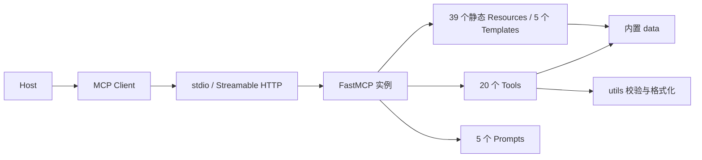

# learn-mcp-server 项目详细检查报告

检查日期：2026-10-08（Asia/Shanghai）

检查目录：E:/SoftwareProject/learn-mcp-server

检查基准提交：6b8d7d96692cf6139b06bbcefbe7dc378ee34b67

## 1. 总体判断

项目已经具备完整、可运行的 MCP 学习示例骨架。能力注册、基本协议调用、stdio、Streamable HTTP、构建和独立 wheel 安装均通过了实际验证。模块拆分适合当前规模，尚没有必要引入数据库、复杂服务层或大型框架。

主要问题是：若干工具的实现没有兑现教学语义，输入验证存在缺口，HTTP 服务缺少 Origin 校验，现有测试对异常分支和真实传输的覆盖不足。它适合继续作为本地学习项目使用；面向他人分发时，建议先修复本报告中的 P2 问题，并处理依赖维护项。

本次没有发现能够据此确认的 P0/P1 严重漏洞。发现的依赖公告不能直接证明当前服务可被利用，具体关联见第 6 节。

本次只生成检查报告和验证数据，没有修改原有业务代码、测试、README、pyproject.toml 或 uv.lock，没有提交代码或发布包。

## 2. 检查范围与环境

已逐文件检查全部 28 个源码 Python 文件、8 个测试文件和 1 个客户端示例，共 37 个 Python 文件；同时检查 README、设计路线文档、配置示例、包元数据、锁文件及构建产物。源码共 2,052 行，测试共 870 行，行数包含文档字符串和空行。

| 项目 | 实际结果 |
| --- | --- |
| 操作系统 / Shell | Windows / PowerShell |
| 项目解释器 | Python 3.10.18 |
| 系统默认 Python | 3.12.4，本次主要验证使用项目解释器 |
| 项目版本 | 0.1.0 |
| FastMCP / MCP SDK | 3.3.1 / 1.27.2 |
| pytest / Pydantic | 9.0.3 / 2.13.4 |
| Starlette / Uvicorn | 1.2.1 / 0.48.0 |
| uv | 0.9.7 |
| 临时检查工具 | coverage、Ruff 0.16.10、mypy 2.4.0、pip-audit 2.10.1 |
| 检查前 Git 状态 | 工作区无已跟踪文件改动 |
| AGENTS.md | 项目和所检查的上级目录中未发现 |

临时工具、隔离安装环境和构建产物位于系统临时目录；没有把检查工具加入项目依赖。

### 2.1 实际验证矩阵

| 检查 | 结果 | 说明 |
| --- | --- | --- |
| 原有测试 | 99 / 99 通过 | 使用冻结锁文件运行 |
| 锁文件一致性 | 通过 | `uv lock --check` |
| 安装依赖兼容性 | 通过 | `uv pip check`，检查 79 个已安装包 |
| Python 语法解析 | 37 / 37 通过 | 包括源码、测试和客户端示例 |
| 内存 MCP 工具调用 | 20 / 20 通过 | 每个工具至少一组正常参数 |
| 静态 Resource 读取 | 39 / 39 通过 | 通过 MCP Client 逐个读取 |
| Resource Template 内容 | 43 / 43 通过 | 全部内置键值；另以大写路径避开同名静态路由，确认模板实际分发 |
| Prompt 获取 | 5 / 5 通过 | 包括协议层字符串参数转换 |
| 真实 stdio 子进程 | 通过 | console script 启动、发现能力、调用工具、读取模板、获取 Prompt |
| stdio 原始 stdout | 通过 | 初始化响应为合法 JSON-RPC，无额外普通输出 |
| 真实 HTTP 服务 | 通过 | 独立子进程、临时本地端口、真实 TCP / HTTP 连接 |
| HTTP Origin / Host 探测 | 存在问题 | 外部 Origin 和伪造 Host 均接受初始化，详见 F01 |
| README 客户端脚本 | 通过 | `examples/client_test.py` |
| 内置示例代码 | 通过基础验证 | 8 组语法解析；7 组装饰器片段实际注册；完整 Client 示例 API 另行验证 |
| sdist / wheel 构建 | 通过 | 从 sdist 构建 wheel 成功 |
| wheel 独立安装 | 通过 | 安装锁定运行依赖后，在项目目录外导入并使用已安装 wheel |
| Ruff 基础错误规则 | 通过 | 显式隔离配置，E4/E7/E9/F |
| Ruff 导入及导出排序 | 14 项提示 | 显式启用 I / RUF022；属于风格，不是运行错误 |
| Ruff 格式检查 | 17 个文件需格式化 | 默认格式标准下的结果 |
| mypy 源码检查 | 2 项类型错误 | 数据结构推断问题，见第 7 节 |
| 依赖公告扫描 | 40 条记录 / 29 条去重公告 | 7 个锁定依赖涉及 27 条；2 个环境工具包涉及 2 条 |

注意：Ruff 的风格规则和 mypy 是本次额外检查，并非仓库已经声明的 CI 门禁。首次 Ruff 运行读取到了外部配置，随后使用 `--isolated` 和显式规则重新确认了结果。

## 3. 架构与实现质量

### 3.1 当前运行链路



[server.py](E:/SoftwareProject/learn-mcp-server/src/learn_mcp_server/server.py:7) 创建 FastMCP 实例；[registry.py](E:/SoftwareProject/learn-mcp-server/src/learn_mcp_server/registry.py:112) 集中注册能力；[settings.py](E:/SoftwareProject/learn-mcp-server/src/learn_mcp_server/settings.py:12) 读取 transport 环境变量。

### 3.2 值得保留的设计

- 业务模块不反向导入 server，依赖方向清晰，现有结构测试也在保护这一点。
- src 布局、console script 和 Hatchling 构建配置完整，独立 wheel 验证排除了“只在工作区能运行”的问题。
- 注册清单和函数实现分离，静态资源与模板 URI 无重复。
- 工具参数和返回值都有类型注解，正常参数会形成可用的输入 schema；协议层能够拒绝缺失参数和错误列表元素类型。
- 内置知识查询均为静态数据处理，没有发现用户输入进入项目自身的系统命令执行、动态 Python 执行、文件访问、数据库访问或外部网络请求。
- 实际 stdout 检查未发现普通日志污染 stdio 通道。
- README 的 20 / 39 / 5 / 5 数量与实际协议清单一致，版本号在包元数据与包初始化文件中一致。
- Git 忽略了 .env、虚拟环境、缓存和 dist；已跟踪环境文件只有 .env.example。

### 3.3 模块逐项判断

| 模块 | 判断 |
| --- | --- |
| server / settings | 启动可用；缺少显式项目协议版本、HTTP Origin 防护配置；.env 不自动加载 |
| registry | 集中注册适合现状；注册别名与实际函数名存在潜在双重维护，但当前名称一致 |
| basic_tools | 基础介绍与列表正常；LEARNING_MODULES 建议补充 TypedDict |
| concept_tools | 查询正常；对比功能主要拼接两段定义，针对性比较较弱 |
| example_tools / data.examples | 示例可读取、基础代码有效；多数是片段，缺少完整启动脚手架 |
| config_tools | 主要输入校验缺陷集中在这里，见 F02—F04 |
| practice_tools | 分级计划、答案反馈和学习衔接存在明确逻辑问题，见 F05—F07 |
| debug_tools | 规则匹配过宽，可能给出错误方向，见 F10 |
| resources | 读取与 URI 映射正常；静态资源说明元数据缺失 |
| prompts | 正常参数可用；业务范围校验与发现说明不足，见 F09、F13 |
| data | 有课程分级及练习数据基础；部分教学说明需要更准确，见 F08、F14 |
| tests | 回归基础良好；多数断言检查关键词，不能验证教学结论正确性 |

## 4. 问题总表

本报告的 P2 表示应在面向他人使用前修复的功能、协议防护或教学准确性问题；P3 表示较低风险的体验、元数据、可维护性问题。F12 是依赖维护项，尚未确认当前服务具备公告所需的利用条件。

| 编号 | 优先级 | 问题 |
| --- | --- | --- |
| F01 | P2 | HTTP 接受无关 Origin 和伪造 Host，缺少协议要求的 Origin 校验 |
| F02 | P2 | explain_config 对合法非对象 JSON 触发 AttributeError |
| F03 | P2 | explain_config 将字段类型错误、传输字段冲突的配置判定为正常 stdio |
| F04 | P2 | generate_http_config 接受完全无效的 HTTP 地址 |
| F05 | P2 | 三种学习等级只有标题变化，实际计划内容完全一致 |
| F06 | P2 | 仅命中一个关键词就判定答案良好，错误答案也会被肯定 |
| F07 | P2 | 学习建议指向缺失的 tests 概念，并可能回到 Tool 形成循环 |
| F08 | P2 | roots 教学没有说明边界不会自动由协议强制执行 |
| F09 | P3 | 学习计划 Prompt 接受 0 天、负数天和不合理天数 |
| F10 | P3 | 错误诊断规则宽泛，实际问题容易被错误分类 |
| F11 | P3 | MCP 初始化返回 FastMCP 版本，而非项目版本 |
| F12 | P2 维护 | 锁定依赖存在已知公告，需要按实际使用路径处理 |
| F13 | P3 | 5 个 Prompt、39 个静态 Resource 缺少 description |
| F14 | P3 | 内置入门课程的 Inspector 命令与 README 的 Windows 指引不一致 |

## 5. 详细问题、复现与修复方向

### F01：HTTP 缺少 Origin 校验

位置：[server.py:11](E:/SoftwareProject/learn-mcp-server/src/learn_mcp_server/server.py:11)、[server.py:23](E:/SoftwareProject/learn-mcp-server/src/learn_mcp_server/server.py:23)。

项目只创建默认 FastMCP 实例并直接启动 HTTP，未配置 Origin 允许列表或相应中间件。

本次启动真实本地 HTTP 子进程，对 /mcp 发送相同 initialize 请求。客户端使用 `trust_env=False` 排除环境代理对结果的影响：

| 请求头 | 实际 HTTP 状态 | 是否成功返回 MCP 初始化 |
| --- | --- | --- |
| 正常请求 | 200 | 是 |
| Origin: https://audit.invalid | 200 | 是 |
| Host: audit.invalid | 200 | 是 |
| 上述 Origin 和 Host 同时出现 | 200 | 是 |

[MCP 2025-11-25 Streamable HTTP 规范](https://modelcontextprotocol.io/specification/2025-11-25/basic/transports#streamable-http) 明确要求校验传入 Origin；存在且无效的 Origin 必须返回 403。

当前工具仅处理内置知识，尚未观察到文件、凭证或外部系统的直接暴露。这里确认的是请求防护和协议要求缺口，未进行浏览器中的完整攻击链验证。Host 允许列表可作为额外防护；不能把绑定 127.0.0.1 当作替代 Origin 校验的机制。

建议：在 HTTP 层显式设置允许的 Origin，拒绝无关 Origin，保留合法本地客户端的无 Origin 请求；同时限制 Host。增加真实请求断言，确保无效 Origin 返回 403。将来开放远程部署时，应明确认证方案。

### F02：合法非对象 JSON 会使配置解释工具异常

位置：[config_tools.py:18](E:/SoftwareProject/learn-mcp-server/src/learn_mcp_server/tools/config_tools.py:18)。

```python
explain_config("[]")
explain_config("null")
explain_config('"value"')
explain_config("42")
explain_config("true")
```

以上都是合法 JSON，json.loads 不会报 JSONDecodeError；随后对 list、None、str、int 或 bool 调用 .get，直接触发 AttributeError。

通过 MCP 调用时返回工具错误，例如：

```text
Error calling tool 'explain_config': 'list' object has no attribute 'get'
```

影响：用户需要解释“格式正确但结构错误”的配置时，收到内部 Python 错误，无法得到应有的结构诊断。FastMCP 将异常转换成工具错误，未观察到整个服务因此退出。

建议：解析 JSON 后先检查顶层为 dict，再检查 mcpServers。对合法 JSON 的错误结构给出明确说明。增加对象、数组、null、字符串、数字、布尔值的参数化用例。

### F03：配置字段的类型错误和冲突没有被识别

位置：[config_tools.py:30](E:/SoftwareProject/learn-mcp-server/src/learn_mcp_server/tools/config_tools.py:30)。

```json
{"mcpServers":{"bad":{"command":17,"args":"server.py"}}}
```

实际输出包含“这是一个 stdio 配置”，随后原样展示 command: 17 和 args: server.py，没有指出无法正常启动所需的字段类型。

```json
{"mcpServers":{"bad":{"command":"python","url":"https://example.com/mcp"}}}
```

实际仍判定为 stdio，url 被忽略。对没有指定 Host 方言的通用教学配置，应该指出两个传输入口同时存在、需要确认配置模式。

建议：基于支持的 Host 配置结构检查 command 非空字符串、args 字符串列表、url 合法 HTTP URL；识别字段冲突和空 mcpServers。解释工具可以输出诊断文字，但不应把明显错误的配置描述为正常可用。

### F04：HTTP 配置生成器只检查非空

位置：[config_tools.py:66](E:/SoftwareProject/learn-mcp-server/src/learn_mcp_server/tools/config_tools.py:66)。

```python
generate_http_config("javascript:alert(1)")
generate_http_config("not-a-url")
```

这些字符串都会被生成到 url 字段，调用仍然成功。前一项已通过 MCP 协议层验证。

影响：工具生成结构合法、实际无法连接的 Host 配置，学习者很可能把问题归因于 transport 或服务启动。

建议：解析 URL，要求 http/https scheme、有效主机及合法端口。允许远程 HTTPS 地址和自定义 MCP 路径，不要把 /mcp 强制为唯一合法路径。这里没有发生外部请求，因此它是配置正确性问题，不是已经证实的 SSRF。

### F05：学习等级只改变标题

位置：[practice_tools.py:11](E:/SoftwareProject/learn-mcp-server/src/learn_mcp_server/tools/practice_tools.py:11)。

beginner、intermediate、advanced 仅选择三个不同标题，第 1—7 天正文完全相同。本次去除标题后比较，三个结果完全一致。未知等级 expert 也静默返回入门计划。

同时，[data/curriculum.py](E:/SoftwareProject/learn-mcp-server/src/learn_mcp_server/data/curriculum.py:1) 已维护了不同的三级课程，其中高级课程包括能力协商、sampling、elicitation、roots、安全和任务状态；工具没有使用这些分级内容。

建议：将学习计划与 CURRICULUMS 或独立结构化课程数据对齐；明确支持的等级，未知等级返回可选值或说明。测试应验证各等级的实质目标和练习不同。

### F06：答案检查会肯定明显错误的答案

位置：[practice_tools.py:69](E:/SoftwareProject/learn-mcp-server/src/learn_mcp_server/tools/practice_tools.py:69)、[practice_tools.py:74](E:/SoftwareProject/learn-mcp-server/src/learn_mcp_server/tools/practice_tools.py:74)。

```python
check_answer("tool", "tool")
check_answer("tool", "Tool 绝对不能执行动作，只能当作上下文文档。")
```

两者都会得到“答得不错，你的回答已经覆盖了 Tool 练习 的关键点”。

原因：字符串包含任意一个关键词就进入肯定分支，没有完整性要求，也没有判断否定语义。关键词匹配只能说明提到了某个词，无法确认概念理解正确。

建议：如果继续采用确定性规则，将反馈明确表述为“关键词覆盖检查”，输出已覆盖和缺失项，避免宣称答案正确；需要语义评价时，可以提供学习评审 Prompt，交由 Host 模型评价。单纯提高关键词命中数量仍不能解决否定句误判。

### F07：下一步建议断链并可能循环

位置：[practice_tools.py:113](E:/SoftwareProject/learn-mcp-server/src/learn_mcp_server/tools/practice_tools.py:113)、[practice_tools.py:132](E:/SoftwareProject/learn-mcp-server/src/learn_mcp_server/tools/practice_tools.py:132)。

```python
suggest_next_step("debug")  # 推荐 tests，并要求 explain_concept("tests")
explain_concept("tests")    # 没有找到概念
suggest_next_step("tests")  # 默认退回 tool
```

tests 不在 CONCEPTS 中。学习者沿工具建议操作，到最后一步会看到缺失概念；继续询问又可能回到 Tool。

建议：补充 tests 教学入口，或把最后一步明确设计成运行测试 / 项目验收，并表示路线完成。对全部映射项检查目标存在；不要让统一建议模板把非概念动作转换成 explain_concept 调用。

### F08：roots 不能被讲解为自动生效的文件访问限制

位置：[data/concepts.py:103](E:/SoftwareProject/learn-mcp-server/src/learn_mcp_server/data/concepts.py:103)、[data/curriculum.py:84](E:/SoftwareProject/learn-mcp-server/src/learn_mcp_server/data/curriculum.py:84)。

当前文本将 roots 描述为“可访问工作区范围”，并说明它能“限制边界，避免 Server……访问不该访问的位置”，但缺少关键限定：传递 roots 本身不会建立操作系统沙箱，也不会自动撤销 Python 进程对其他文件的权限。

[MCP roots 规范](https://modelcontextprotocol.io/specification/2025-11-25/client/roots#security-considerations) 要求 Server 自行尊重边界并验证路径；这正说明实际访问限制仍需实现。

建议：说明 roots 是客户端提供的工作范围信息；Server 必须自行校验路径及处理符号链接，真正的强制隔离来自运行环境权限、沙箱或容器。当前项目没有文件读取工具，因此这项是教学准确性问题，不能据此断言当前存在路径遍历漏洞。

### F09：学习计划 Prompt 的天数缺少业务范围约束

位置：[learning_prompts.py:14](E:/SoftwareProject/learn-mcp-server/src/learn_mcp_server/prompts/learning_prompts.py:14)。

通过 MCP get_prompt，days 为字符串 "0"、"-1"、"1000000" 时均成功返回对应天数的计划指令；"nope" 会被类型转换拒绝。

影响：类型检查只保证整数，不能保证计划合理。负数和零天数直接产生语义无效的请求。

建议：要求正整数，并根据产品需要设置合理上限；对 level、topic 的空白输入也作一致处理。不要把所有开放文本主题都收紧为内置概念枚举，Prompt 可以支持用户自己的主题。

### F10：诊断规则会把明确症状分类到错误方向

位置：[debug_tools.py:25](E:/SoftwareProject/learn-mcp-server/src/learn_mcp_server/tools/debug_tools.py:25)、[debug_tools.py:76](E:/SoftwareProject/learn-mcp-server/src/learn_mcp_server/tools/debug_tools.py:76)。

已复现：

- diagnose_issue("FastMCP HTTP connection refused") 返回依赖问题诊断，因为只要出现 fastmcp 就命中依赖分支。
- explain_error_message("JSON parse error on stdout because print polluted stdio") 返回 JSON 配置格式问题，因为 json 分支早于 stdout / print 分支。

建议：优先匹配明确的异常类型和症状，对多个命中原因给出候选排查路径；区分 JSON 配置解析与 stdio 协议解析。uvx 是项目推荐方案，不应把使用其他合法启动器直接写成配置错误。

### F11：协议返回了框架版本而非项目版本

位置：[server.py:11](E:/SoftwareProject/learn-mcp-server/src/learn_mcp_server/server.py:11)。

项目包版本为 0.1.0，实际 initialize 响应却包含：

```json
{"serverInfo":{"name":"learn-mcp-server","version":"3.3.1"}}
```

这是创建 FastMCP 时未传 version 的结果。stdio 原始响应和 HTTP 响应都已确认。

建议：将包 __version__ 显式传给 FastMCP。Host 展示和问题反馈才能对应项目发布版本；增加初始化元数据断言。

### F12：依赖维护缺少公告检查与兼容范围

位置：[pyproject.toml:27](E:/SoftwareProject/learn-mcp-server/pyproject.toml:27)、[uv.lock](E:/SoftwareProject/learn-mcp-server/uv.lock)。

pyproject 只声明 fastmcp，没有最低兼容版本或上界。工作区锁文件能固定当前环境；用户通过 wheel / uvx 安装时，安装器不会采用仓库 uv.lock，依赖会按发布元数据重新解析。

本次安装环境扫描有 40 条公告记录，按每个包的公告 ID 去重后为 29 条。27 条涉及 7 个锁定依赖，另外 2 条来自锁文件外的 pip 和 setuptools。详细适用性见下一节。

建议：确认经过验证的 FastMCP 兼容范围；建立定期依赖更新和公告扫描；更新锁文件后在干净环境重新验证两种 transport。不要为了凑齐扫描零告警而盲目升级全部包，尤其要检查 Python 3.10 与新版本依赖的兼容性。

### F13：能力发现元数据不完整

位置：[learning_prompts.py:1](E:/SoftwareProject/learn-mcp-server/src/learn_mcp_server/prompts/learning_prompts.py:1)、[registry.py:117](E:/SoftwareProject/learn-mcp-server/src/learn_mcp_server/registry.py:117)、[registry.py:125](E:/SoftwareProject/learn-mcp-server/src/learn_mcp_server/registry.py:125)。

实际 list_prompts 的 5 项和 list_resources 的 39 项均没有 description。20 个 Tool 的 description 均存在，但都没有 annotations。

影响：Host 可以列出能力，却缺少帮助用户区分使用场景的说明。它们仍然可正常调用，元数据缺失没有阻止协议运行。

建议：补充简短用途说明，Markdown 资源明确 mime_type；对当前纯读取 / 生成文本的工具按真实行为标注只读、非破坏性、幂等性。annotations 是提示性信息，不能替代权限或输入验证。

### F14：课程内的 Inspector 操作指导已与 README 分离

位置：[data/curriculum.py:29](E:/SoftwareProject/learn-mcp-server/src/learn_mcp_server/data/curriculum.py:29)。

内置 Beginner 课程仍推荐：

```text
uv run fastmcp dev inspector src\learn_mcp_server\server.py
```

README 则明确说明 Windows 使用正斜杠绝对路径、:mcp 对象和 --no-reload。课程资源是用户直接读取的教学内容，不应该继续给出与已维护指引相冲突的命令。

建议：统一命令说明，注明替换项目路径，避免写死作者机器目录。本次未启动 Inspector 浏览器 UI，因此这里确认的是文档不一致，不宣称该命令在所有环境必然失败。

## 6. 依赖公告的实际关联

扫描工具是 pip-audit 2.10.1，对当前环境 78 个依赖分发包执行公告查询，排除了项目自身，使用 --no-deps / --disable-pip 避免重新解析或安装被扫描依赖。没有跳过包。

公告数据存在重复 ID，所以不能把原始“40 条”直接写成“40 个独立漏洞”。

| 包 | 当前版本 | 去重公告数 | 扫描数据列出的修复版本 | 与当前项目的关联 |
| --- | --- | --- | --- | --- |
| PyJWT | 2.13.0 | 14 | 多项 2.14.0，部分 2.15.0，1 项未列修复版本 | 项目未配置 JWT / OAuth 认证；尚未看到相关验证路径被使用 |
| anyio | 4.13.0 | 2 | 4.14.2 | 公告涉及国际化域名 TLS 和进程池 stderr；项目无相关业务路径 |
| cryptography | 48.0.0 | 4 | 48.0.1、49.0.0、50.0.0，分别修复不同项 | 包含证书验证、PKCS7 及 wheel 内 OpenSSL；没有观察到对应应用调用 |
| mcp | 1.27.2 | 1 | 1.28.1 | 公告只影响自行暴露的废弃 WebSocket server transport；当前两种传输不在其影响范围 |
| pydantic-settings | 2.14.1 | 1 | 2.14.2 | 需要特定嵌套 secrets 目录和可控符号链接条件；当前未配置该路径 |
| python-multipart | 0.0.29 | 3 | 0.0.30、0.0.31 | 涉及表单解析；项目 MCP 端点以 JSON 通信，未注册表单处理业务 |
| starlette | 1.2.1 | 2 | 1.3.0、1.3.1 | 涉及表单限制与 request.url 解析；需要检查部署层和未来自定义路由 |
| pip | 26.1.2 | 1 | 26.2 / 26.2.0 | 环境工具，不在 uv.lock；需要恶意包索引等安装阶段条件 |
| setuptools | 82.0.1 | 1 | 83.0.0 | 环境工具，不在 uv.lock；公告与 macOS 文件名归一化打包相关，项目构建使用 Hatchling |

修复版本是公告中的信息，不能据此保证该版本组合一定可安装、一定解决全部告警，或适合当前 Python 版本。

特别需要分清：

1. mcp 的 [GHSA-vj7q-gjh5-988w](https://github.com/advisories/GHSA-vj7q-gjh5-988w) 针对 WebSocket transport，不能用来证明 F01 的 Streamable HTTP 问题；F01 来自独立的真实请求验证。
2. PyJWT 的公告包含算法混用、JWK 解析、缓存和 options 复用等不同前提。项目未开启认证，不能断言有 14 条可远程利用的认证漏洞。
3. 当前工具均为静态知识处理；扫描结果应作为依赖维护清单，而不是夸大的当前攻击面清单。
4. 扫描之外仍需实现 HTTP Origin 防护，单纯升级依赖不能替代项目层面的安全配置验证。

当前环境还存在锁文件之外的 backports.tarfile、jaraco.classes、jaraco.context、jaraco.functools、pip、setuptools。冻结运行不意味着现存虚拟环境没有额外包；本次独立 wheel 环境另外排除了工作区和这些环境残留的影响。

## 7. 测试与静态检查的具体评价

### 7.1 现有 99 项测试分布

| 测试文件 | 用例数 |
| --- | --- |
| test_tools.py | 35 |
| test_resources.py | 36 |
| test_utils.py | 8 |
| test_structure.py | 6 |
| test_prompts.py | 5 |
| test_examples.py | 4 |
| test_settings.py | 3 |
| test_mcp_integration.py | 2 |

99 个测试全部通过是有效的回归基础，但不等于功能语义已正确。例如 check_answer 的现有测试只要求正确示例得到“答得不错”，没有断言错误答案不能得到这句话。

### 7.2 覆盖率

仅针对原有测试测量，未把本次临时探测混入统计：

| 指标 | 结果 |
| --- | --- |
| 语句覆盖 | 365 / 400 = 91.25% |
| 分支覆盖 | 42 / 64 = 65.625% |
| 语句与分支合并指标 | 87.72%，coverage 显示为 88% |
| 未覆盖语句 | 35 |
| 未覆盖分支 | 22 |

| 核心文件 | coverage 合并指标 | 主要缺口 |
| --- | --- | --- |
| debug_tools.py | 50% | Resource 分支、通用回退、JSON / HTTP / stdout 错误分支 |
| config_tools.py | 75% | 缺少 mcpServers、非对象子配置、HTTP / 未知 transport 字段 |
| practice_tools.py | 78% | 未知练习、未知答案主题、无关键词反馈 |
| concept_tools.py | 78% | 对比时左右未知概念分支 |
| server.py | 79% | 原有测试未执行 main 与直接脚本入口 |
| example_tools.py | 89% | 未知示例解释分支 |

大量静态资源是“一条 return 返回整段文档”，所以源码行数很多、实际可执行语句很少。此类文件 100% 覆盖只能说明返回语句执行过，不能说明文档里的命令或概念准确。

### 7.3 原有集成测试的边界

[test_mcp_integration.py:14](E:/SoftwareProject/learn-mcp-server/tests/test_mcp_integration.py:14) 使用 Client(mcp)，验证内存中的 MCP 服务。它能证明发现和调用 API 可用，但没有启动 console script，也没有经过真实 stdio 或 HTTP 网络路径。

清单断言使用集合包含关系，因此只要求部分能力存在；注册清单丢失未列出的 Tool 时，可能仍通过这部分测试。README 数量检查对注册表进行比较，也不能单独保证所有注册项最终被协议暴露。

建议保留函数级测试，同时补充：

- 参数化的配置 JSON 类型 / 字段错误用例。
- 等级差异、错误答案、完整学习路线的行为断言。
- 全量注册清单与真实协议能力清单的相等比较。
- stdio console script 和 HTTP 服务的少量稳定集成用例。
- Origin 拒绝、协议版本信息、非法 Prompt 天数的断言。

### 7.4 类型检查

mypy 检查 28 个源码文件，报告 2 项：

```text
basic_tools.py:35: append 收到 Sequence[str]，预期 str
basic_tools.py:38: format_markdown_list 收到 Sequence[str]，预期 list[str]
```

实际运行数据是正确的。原因是 LEARNING_MODULES 没有结构类型，同一个 dict 混合字符串和字符串列表，静态工具无法准确区分 description 与 topics。

建议为学习模块定义 TypedDict，后续也可为练习数据和注册清单使用明确的结构类型。这是静态契约问题，不应描述成已经发生的运行崩溃。

### 7.5 风格、CI 和结构测试

- 14 项 Ruff 提示全部是导入排序或 __all__ 排序。
- 默认 Ruff formatter 认为 17 个文件需要格式化；没有应用修复。
- 仓库没有已跟踪的 YAML CI 工作流，也没有已声明的 Ruff / mypy 检查配置。
- “server.py 不超过 60 行”“源码包含特定字符串”“__all__ 字符串存在”等结构测试比较脆弱，无法代替真实行为验证。
- 单元测试通过 server 模块的动态 globals 导出访问函数。建议直接从功能模块导入函数，减少对注册方式和装饰器返回行为的耦合。

## 8. 打包、配置和文档

### 8.1 构建与安装

本次成功生成 sdist 和 py3-none-any wheel；wheel 共 33 个条目，包含全部 28 个源码模块、元数据、入口与 MIT LICENSE。未发现 .env、.idea、缓存或测试被装入 wheel。

sdist 包含测试、examples 和 uv.lock。独立环境从 wheel 导入包，导入路径位于该环境 site-packages；随后通过已安装 console script 完成 20 / 39 / 5 / 5 清单查询以及工具、资源和 Prompt 使用。

该验证使用锁定运行依赖，不是发布到 PyPI 后的真实安装验证。本次没有发布、下载对比同名 PyPI 包，也不能据此确认发布索引上的 0.1.0 内容与工作区一致。

### 8.2 配置行为

- LEARN_MCP_TRANSPORT 会去除首尾空格并转小写；不支持的值会报 ValueError。
- .env.example 存在，但项目代码没有读取 .env 的逻辑；uv run 默认也不会替项目读取该文件。README 使用环境变量赋值的运行方式是有效的。
- 如果希望用户修改 .env 便生效，应明确使用 uv 的 --env-file 或实现可控的 dotenv 加载；否则在文档中说明它只是环境变量示例。
- HTTP 地址默认来自 FastMCP 设置：本次确认 127.0.0.1:8000/mcp。FASTMCP_HOST / FASTMCP_PORT 能覆盖这些默认值，但 README 没有说明。
- mcpServers JSON 是特定 Host 生态的常见配置形状，不是 MCP 协议强制统一的配置文件格式。项目目前不应让用户认为一份 JSON 能直接适用于所有 Host。

### 8.3 教学内容的后续提升

- 最小示例普遍假设已有 mcp 对象；可保留片段，但至少提供一个包含 import、FastMCP 实例和 main 的完整可运行示例。
- Resource 的控制通常属于应用，Prompt 通常由用户选择，Tool 通常由模型选择；建议补充这些区别，避免仅以“模型可读 / 模型可用”概括三种原语。
- 生命周期应补充 initialize、initialized 通知、协议版本与能力协商，不仅是“初始化后查询能力”。
- Authorization 文档可以进一步区分访问认证 / OAuth 与敏感工具执行前的用户确认。
- compare_concepts 当前主要把两段概念并排展示；可以增加职责、触发方、输入、输出和适用场景的具体比较。
- explain_code_example 的统一装饰器说明不适合 end-to-end-client；该示例是客户端流程，没有注册能力装饰器。
- 课程资源中的命令、README、设计文档和配置知识文本应共享维护来源，减少多处复制后漂移。

这些提升是教学深度建议，未将其全部列为运行缺陷。

## 9. 建议的修复顺序

### 第一批：先恢复正确行为和协议防护

1. 增加 HTTP Origin 校验和真实拒绝请求用例，解决 F01。
2. 修复配置顶层结构、字段校验和 URL 校验，解决 F02—F04。
3. 让学习等级对应不同计划，降低关键词检查反馈的结论强度，修复路线终点，解决 F05—F07。
4. 修正 roots 安全说明，解决 F08。

### 第二批：补足维护与调用体验

1. 按第 6 节梳理依赖公告，更新经过验证的兼容版本组合并重新锁定。
2. 校验 Prompt 的天数与空白输入，优化诊断规则。
3. 显式传项目协议版本，补充能力元数据，统一 Inspector 指引。
4. 为 LEARNING_MODULES 增加 TypedDict；单元测试改为导入功能模块。

### 第三批：形成稳定的工程检查

1. 统一 Ruff 配置和格式化标准，把 pytest、基础 lint、打包验证加入 CI。
2. 给真实 stdio / HTTP 各保留一条代表性集成流程，避免只测内存服务。
3. 在所声明支持的 Python 版本及目标系统中建立小型兼容矩阵。
4. 依赖更新后重新扫描和回归，不需要增加与实现逐行重复的测试。

## 10. 证据文件与复核命令

| 文件 | 内容 |
| --- | --- |
| [dynamic-audit.json](E:/SoftwareProject/learn-mcp-server/docs/archive/2026-10-08/audit-2026-10-08/dynamic-audit.json) | 全量协议调用、错误输入、schema、元数据、stdio 初始化响应 |
| [http-origin-probe.json](E:/SoftwareProject/learn-mcp-server/docs/archive/2026-10-08/audit-2026-10-08/http-origin-probe.json) | 排除环境代理后的 HTTP Origin / Host 探测 |
| [dependency-audit.json](E:/SoftwareProject/learn-mcp-server/docs/archive/2026-10-08/audit-2026-10-08/dependency-audit.json) | 原始依赖公告记录、修复版本及说明，包含重复 ID |
| [coverage.json](E:/SoftwareProject/learn-mcp-server/docs/archive/2026-10-08/audit-2026-10-08/coverage.json) | 原有 99 项测试的语句 / 分支覆盖数据 |

关键复核命令：

```powershell
uv lock --check
uv run --frozen pytest -o addopts='' -q
uv run --frozen python examples/client_test.py
uv pip check --python .venv/Scripts/python.exe
uvx ruff check --isolated --select E4,E7,E9,F src tests examples
uvx ruff check --isolated --select E4,E7,E9,F,I,RUF022 src tests examples
uvx mypy --python-executable .venv/Scripts/python.exe --ignore-missing-imports src/learn_mcp_server
uv build
```

覆盖率与依赖扫描数据是检查时的快照。再次查询公告或使用不固定版本的 uvx 检查工具，结果可能变化。

## 11. 验证限制

- 已验证 Windows、项目 Python 3.10.18 和锁定依赖；没有声称完成 Linux、macOS 或所有 Python >=3.10 版本的运行验证。
- 未操作真实 Host 的配置 UI，未启动 Inspector 浏览器界面，未验证公网反向代理部署。
- HTTP 探测确认无效 Origin / Host 被接受，但没有执行浏览器中的完整攻击利用链。
- 没有执行破坏性负载、无限请求或高并发压力测试；不能据此给出生产吞吐量和资源上限结论。
- 已跟踪文件的常见私钥 / Access Key / API Key 模式扫描未发现候选；没有输出本地 .env 内容，没有声称完成所有历史提交和全部密钥类型的审计。
- stdio 子进程测试在 Windows Python 3.10 退出阶段观察到 asyncio pipe transport 析构警告，功能断言和退出码正常。警告来自 Python / 客户端依赖的清理路径，尚未定位到项目实现，应在后续环境升级时复查，不能把它描述成当前业务调用失败。
